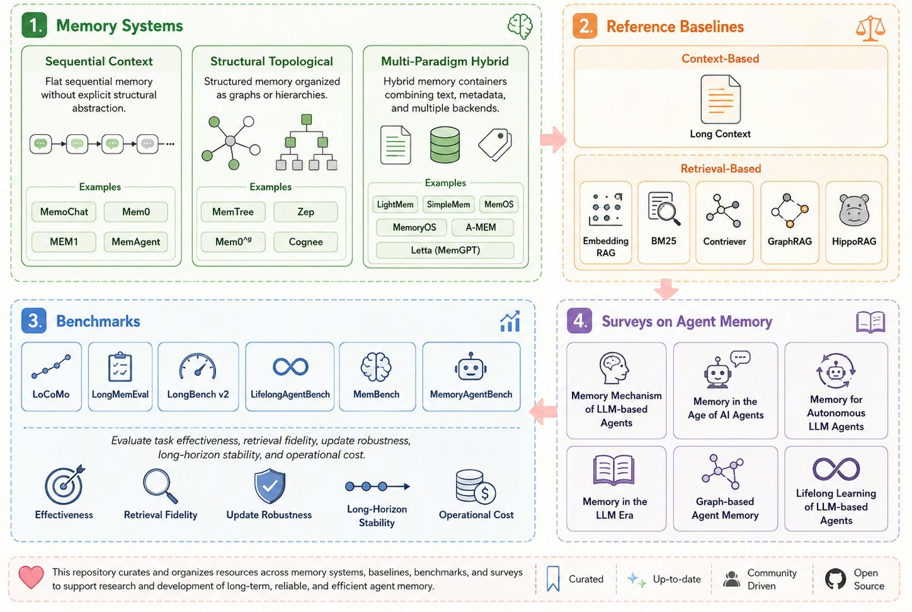

# Awesome Agent Memory

A curated taxonomy of **agent memory systems**, organized along four axes: (1) memory system architectures — from flat sequential context, to structural topological graphs/trees, to multi-paradigm hybrid containers; (2) reference baselines for comparison; (3) benchmarks for evaluation; and (4) surveys on agent memory.

## 📣 Get Involved

- 📊 **Looking for a testbed to evaluate agent memory systems?** See our companion repo [OpenDataBox/MemoryData](https://github.com/OpenDataBox/MemoryData) — an integrated platform of memory systems and datasets.
- 📌 **Missing a paper, method, or benchmark?** [Open an issue](https://github.com/OpenDataBox/awesome-agent-memory/issues/new) to request it.
- 🤝 **Want to contribute directly?** [Submit a Pull Request](https://github.com/OpenDataBox/awesome-agent-memory/compare) — community PRs are warmly welcomed!



## Table of Contents

- [1. Memory Systems and Methods](#1-memory-systems-and-methods)
  - [1.1 Sequential Memory Systems](#11-sequential-memory-systems)
    - [1.1.1 Discrete Textual Memory](#111-discrete-textual-memory)
    - [1.1.2 Parameter and Latent Memory](#112-parameter-and-latent-memory)
  - [1.2 Structured Topological Memory Systems](#12-structured-topological-memory-systems)
    - [1.2.1 Graph-Based Memory](#121-graph-based-memory)
    - [1.2.2 Hierarchical Memory](#122-hierarchical-memory)
  - [1.3 Composite Memory Systems](#13-composite-memory-systems)
  - [1.4 Baselines and Supporting Methods](#14-baselines-and-supporting-methods)
- [2. Benchmarks and Datasets](#2-benchmarks-and-datasets)
  - [2.1 Effectiveness Evaluation](#21-effectiveness-evaluation)
  - [2.2 Retrieval Evaluation](#22-retrieval-evaluation)
  - [2.3 Robustness Evaluation](#23-robustness-evaluation)
  - [2.4 Efficiency Evaluation](#24-efficiency-evaluation)
- [3. Surveys, Tutorials, and Position Papers](#3-surveys-tutorials-and-position-papers)
- [4. Frameworks, Products, and Resources](#4-frameworks-products-and-resources)
- [Citation](#citation)

## 1. Memory Systems and Methods

### 1.1 Sequential Memory Systems

#### 1.1.1 Discrete Textual Memory

Memory represented as a flat sequence, textual summary, note, trajectory, or experience record without an explicit graph or tree topology.

1. **Evoking User Memory: Personalizing LLM via Recollection-Familiarity Adaptive Retrieval**\
   Yingyi Zhang, Junyi Li, Wenlin Zhang, et al. *ICLR 2026*. [[Paper](https://arxiv.org/abs/2603.09250)]\
       

1. **Exploratory Memory-Augmented LLM Agent via Hybrid On- and Off-Policy Optimization**\
   Zeyuan Liu, Jeonghye Kim, Xufang Luo, et al. *ICLR 2026*. [[Paper](https://arxiv.org/abs/2602.23008)]\
       

1. **Distilling Feedback into Memory-as-a-Tool**\
   Víctor Gallego. *ICLR 2026*. [[Paper](https://arxiv.org/abs/2601.05960)]\
       

1. **The Pensieve Paradigm: Stateful Language Models Mastering Their Own Context**\
   Xiaoyuan Liu, Tian Liang, Dongyang Ma, et al. *ICLR 2026*. [[Paper](https://openreview.net/forum?id=GymjF88oGQ)]\
       

1. **Real-Time Procedural Learning From Experience for AI Agents**\
   Dasheng Bi, Yubin Hu, Mohammed N. Nasir. *ICLR 2026*. [[Paper](https://arxiv.org/abs/2511.22074)]\
       

1. **ReasoningBank: Scaling Agent Self-Evolving with Reasoning Memory**\
   Siru Ouyang, Jun Yan, I-Hung Hsu, et al. *ICLR 2026*. [[Paper](https://arxiv.org/abs/2509.25140)]\
       

1. **MemAgent: Reshaping Long-Context LLM with Multi-Conv RL-based Memory Agent**\
   Hongli Yu, Tinghong Chen, Jiangtao Feng, et al. *ICLR 2026*. [[Paper](https://arxiv.org/abs/2507.02259)] [[Code](https://github.com/BytedTsinghua-SIA/MemAgent)]\
       

1. **Skill-Pro: Learning Reusable Skills from Experience via Non-Parametric PPO for LLM Agents**\
   Qirui Mi, Zhijian Ma, Mengyue Yang, et al. *ICML 2026*. [[Paper](https://arxiv.org/abs/2602.01869)]\
       

1. **EvolveR: Self-Evolving LLM Agents through an Experience-Driven Lifecycle**\
   Rong Wu, Xiaoman Wang, Jianbiao Mei, et al. *ICML 2026*. [[Paper](https://arxiv.org/abs/2510.16079)]\
       

1. **History-Aware Reasoning for GUI Agents**\
   Ziwei Wang, Leyang Yang, Xiaoxuan Tang, et al. *AAAI 2026*. [[Paper](https://arxiv.org/abs/2511.09127)]\
       

1. **ComoRAG: A Cognitive-Inspired Memory-Organized RAG for Stateful Long Narrative Reasoning**\
   Juyuan Wang, Rongchen Zhao, Wei Wei, et al. *AAAI 2026*. [[Paper](https://arxiv.org/abs/2508.10419)]\
       

1. **MemSearcher: Training LLMs to Reason, Search and Manage Memory via End-to-End Reinforcement Learning**\
   Qianhao Yuan, Jie Lou, Zichao Li, et al. *ACL 2026*. [[Paper](https://arxiv.org/abs/2511.02805)]\
       

1. **AutoMem: Automated Learning of Memory as a Cognitive Skill**\
   Shengguang Wu, Hao Zhu, Yuhui Zhang, et al. *arXiv 2026*. [[Paper](https://arxiv.org/abs/2607.01224)]\
       

1. **MemGUI-Agent: An End-to-End Long-Horizon Mobile GUI Agent with Proactive Context Management**\
   Guangyi Liu, Gao Wu, Congxiao Liu, et al. *arXiv 2026*. [[Paper](https://arxiv.org/abs/2606.19926)]\
       

1. **CoreMem: Riemannian Retrieval and Fisher-Guided Distillation for Long-Term Memory in Dialogue Agents**\
   Jiaqi Chen, Yongqin Zeng, Shaoshen Chen, et al. *arXiv 2026*. [[Paper](https://arxiv.org/abs/2606.18406)]\
       

1. **TokenPilot: Cache-Efficient Context Management for LLM Agents**\
   Buqiang Xu, Zirui Xue, Dianmou Chen, et al. *arXiv 2026*. [[Paper](https://arxiv.org/abs/2606.17016)]\
       

1. **HiMPO: Hindsight-Informed Memory Policy Optimization for Less-Entangled Credit in Long-Horizon Agents**\
   Jiangze Yan, Yi Shen, Wenjing Zhang, et al. *arXiv 2026*. [[Paper](https://arxiv.org/abs/2606.16285)]\
       

1. **T-Mem: Memory That Anticipates, Not Archives**\
   Weidong Guo, Dakai Wang, Zixuan Wang, et al. *arXiv 2026*. [[Paper](https://arxiv.org/abs/2606.15405)]\
       

1. **MemRefine: LLM-Guided Compression for Long-Term Agent Memory**\
   Minjae Kim, Jinheon Baek, Soyeong Jeong, et al. *arXiv 2026*. [[Paper](https://arxiv.org/abs/2606.13177)]\
       

1. **Multi-Turn Reasoning When Context Arrives in Pieces: Scalable Sharding and Memory-Augmented RL**\
   Shu Tong Luo, Wenqin Liu, Rui Liu, et al. *arXiv 2026*. [[Paper](https://arxiv.org/abs/2606.12941)]\
       

1. **PROJECTMEM: A Local-First, Event-Sourced Memory and Judgment Layer for AI Coding Agents**\
   Ripon Chandra Malo, Tong Qiu. *arXiv 2026*. [[Paper](https://arxiv.org/abs/2606.12329)]\
       

1. **Infini Memory: Maintainable Topic Documents for Long-Term LLM Agent Memory**\
   Suozhao Ji, Baodong Wu, Zehao Wang, et al. *arXiv 2026*. [[Paper](https://arxiv.org/abs/2606.10677)]\
       

1. **Rosetta Memory: Adaptive Memory for Cross-LLM Agents**\
   Hao Yang, Shiqi Shen, Haoxuan Li, et al. *arXiv 2026*. [[Paper](https://arxiv.org/abs/2606.07711)]\
       

1. **TOKI: A Bitemporal Operator Algebra for Contradiction Resolution in LLM-Agent Persistent Memory**\
   Ziming Wang. *arXiv 2026*. [[Paper](https://arxiv.org/abs/2606.06240)]\
       

1. **EMBER: Efficient Memory via Budgeted Evidence Retention for Long-Horizon Agents**\
   Yilong Li, Suman Banerjee, Tong Che. *arXiv 2026*. [[Paper](https://arxiv.org/abs/2606.05894)]\
       

1. **RAMPART: Registry-based Agentic Memory with Priority-Aware Runtime Transformation**\
   Nikodem Tomczak. *arXiv 2026*. [[Paper](https://arxiv.org/abs/2606.04628)]\
       

1. **Training-Free Lexical-Dense Fusion for Conversational-Memory Retrieval**\
   Christian Lysenstøen. *arXiv 2026*. [[Paper](https://arxiv.org/abs/2606.04194)]\
       

1. **DMF: A Deterministic Memory Framework for Conversational AI Agents**\
   Matteo Stabile, Enrico Zimuel. *arXiv 2026*. [[Paper](https://arxiv.org/abs/2606.03463)]\
       

1. **InfoMem: Training Long-Context Memory Agents with Answer-Conditioned Information Gain**\
   Tiancheng Han, Yong Li, Wuzhou Yu, et al. *arXiv 2026*. [[Paper](https://arxiv.org/abs/2606.03329)]\
       

1. **MemTrain: Self-Supervised Context Memory Training**\
   Ziheng Li, Xingrun Xing, Haoqing Wang, et al. *arXiv 2026*. [[Paper](https://arxiv.org/abs/2606.03197)]\
       

1. **Memory Retrieval for Changing Preferences**\
   Yuehan Qin, Li Li, Linxin Song, et al. *arXiv 2026*. [[Paper](https://arxiv.org/abs/2606.02976)]\
       

1. **Joint Agent Memory and Exploration Learning via Novelty Signals**\
   Shizuo Tian, Xiaohong Weng, Rui Kong, et al. *arXiv 2026*. [[Paper](https://arxiv.org/abs/2606.01528)]\
       

1. **MemPro: Agentic Memory Systems as Evolvable Programs**\
   Qingshan Liu, Guoqing Wang, Wen Wu, et al. *arXiv 2026*. [[Paper](https://arxiv.org/abs/2606.00619)]\
       

1. **CASCADE: Case-Based Continual Adaptation for Large Language Models During Deployment**\
   Siyuan Guo, Yali Du, Hechang Chen, et al. *arXiv 2026*. [[Paper](https://arxiv.org/abs/2605.06702)]\
       

1. **MemReranker: Reasoning-Aware Reranking for Agent Memory Retrieval**\
   Chunyu Li, Mengyuan Zhang, Jingyi Kang, et al. *arXiv 2026*. [[Paper](https://arxiv.org/abs/2605.06132)]\
       

1. **Belief Memory: Agent Memory Under Partial Observability**\
   Junfeng Liao, Qizhou Wang, Jianing Zhu, et al. *arXiv 2026*. [[Paper](https://arxiv.org/abs/2605.05583)]\
       

1. **MemFlow: Intent-Driven Memory Orchestration for Small Language Model Agents**\
   Jiayi Chen, Yingcong Li, Guiling Wang. *arXiv 2026*. [[Paper](https://arxiv.org/abs/2605.03312)]\
       

1. **Learning How and What to Memorize: Cognition-Inspired Two-Stage Optimization for Evolving Memory**\
   Derong Xu, Shuochen Liu, Pengfei Luo, et al. *arXiv 2026*. [[Paper](https://arxiv.org/abs/2605.00702)]\
       

1. **MemRouter: Memory-as-Embedding Routing for Long-Term Conversational Agents**\
   Tianyu Hu, Weikai Lin, Weizhi Zhang, et al. *arXiv 2026*. [[Paper](https://arxiv.org/abs/2605.00356)]\
       

1. **From Unstructured Recall to Schema-Grounded Memory: Reliable AI Memory via Iterative, Schema-Aware Extraction**\
   Alex Petrov, Alexander Gusak, Denis Mukha, et al. *arXiv 2026*. [[Paper](https://arxiv.org/abs/2604.27906)]\
       

1. **Memanto: Typed Semantic Memory with Information-Theoretic Retrieval for Long-Horizon Agents**\
   Seyed Moein Abtahi, Rasa Rahnema, Hetkumar Patel, et al. *arXiv 2026*. [[Paper](https://arxiv.org/abs/2604.22085)]\
       

1. **Gated Memory Policy**\
   Yihuai Gao, Jinyun Liu, Shuang Li, et al. *arXiv 2026*. [[Paper](https://arxiv.org/abs/2604.18933)]\
       

1. **MemSearch-o1: Empowering Large Language Models with Reasoning-Aligned Memory Growth in Agentic Search**\
   Sheng Zhang, Junyi Li, Yingyi Zhang, et al. *arXiv 2026*. [[Paper](https://arxiv.org/abs/2604.17265)]\
       

1. **Trust Your Memory: Verifiable Control of Smart Homes through Reinforcement Learning with Multi-dimensional Rewards**\
   Kai-Yuan Guo, Jiang Wang, Renjie Zhao, et al. *arXiv 2026*. [[Paper](https://arxiv.org/abs/2604.10110)]\
       

1. **Constraint-Aware Corrective Memory for Language-Based Drug Discovery Agents**\
   Maochen Sun, Youzhi Zhang, Gaofeng Meng. *arXiv 2026*. [[Paper](https://arxiv.org/abs/2604.09308)]\
       

1. **MT-OSC: Path for LLMs that Get Lost in Multi-Turn Conversation**\
   Jyotika Singh, Fang Tu, Miguel Ballesteros, et al. *arXiv 2026*. [[Paper](https://arxiv.org/abs/2604.08782)]\
       

1. **Artifacts as Memory Beyond the Agent Boundary**\
   John D. Martin, Fraser Mince, Esra'a Saleh, et al. *arXiv 2026*. [[Paper](https://arxiv.org/abs/2604.08756)]\
       

1. **TSUBASA: Improving Long-Horizon Personalization via Evolving Memory and Self-Learning with Context Distillation**\
   Xinliang Frederick Zhang, Lu Wang. *arXiv 2026*. [[Paper](https://arxiv.org/abs/2604.07894)]\
       

1. **MemReader: From Passive to Active Extraction for Long-Term Agent Memory**\
   Jingyi Kang, Chunyu Li, Ding Chen, et al. *arXiv 2026*. [[Paper](https://arxiv.org/abs/2604.07877)]\
       

1. **LightThinker++: From Reasoning Compression to Memory Management**\
   Yuqi Zhu, Jintian Zhang, Zhenjie Wan, et al. *arXiv 2026*. [[Paper](https://arxiv.org/abs/2604.03679)]\
       

1. **SelRoute: Query-Type-Aware Routing for Long-Term Conversational Memory Retrieval**\
   Matthew McKee. *arXiv 2026*. [[Paper](https://arxiv.org/abs/2604.02431)]\
       

1. **MemRerank: Preference Memory for Personalized Product Reranking**\
   Zhiyuan Peng, Xuyang Wu, Huaixiao Tou, et al. *arXiv 2026*. [[Paper](https://arxiv.org/abs/2603.29247)]\
       

1. **Memento-Skills: Let Agents Design Agents**\
   Huichi Zhou, Siyuan Guo, Anjie Liu, et al. *arXiv 2026*. [[Paper](https://arxiv.org/abs/2603.18743)]\
       

1. **SuperLocalMemory V3: Information-Geometric Foundations for Zero-LLM Enterprise Agent Memory**\
   Varun Pratap Bhardwaj. *arXiv 2026*. [[Paper](https://arxiv.org/abs/2603.14588)]\
       

1. **Structured Distillation for Personalized Agent Memory: 11x Token Reduction with Retrieval Preservation**\
   Sydney Lewis. *arXiv 2026*. [[Paper](https://arxiv.org/abs/2603.13017)]\
       

1. **Trajectory-Informed Memory Generation for Self-Improving Agent Systems**\
   Gaodan Fang, Vatche Isahagian, K. R. Jayaram, et al. *arXiv 2026*. [[Paper](https://arxiv.org/abs/2603.10600)]\
       

1. **TA-Mem: Tool-Augmented Autonomous Memory Retrieval for LLM in Long-Term Conversational QA**\
   Mengwei Yuan, Jianan Liu, Jing Yang, et al. *arXiv 2026*. [[Paper](https://arxiv.org/abs/2603.09297)]\
       

1. **MemSifter: Offloading LLM Memory Retrieval via Outcome-Driven Proxy Reasoning**\
   Jiejun Tan, Zhicheng Dou, Liancheng Zhang, et al. *arXiv 2026*. [[Paper](https://arxiv.org/abs/2603.03379)]\
       

1. **According to Me: Long-Term Personalized Referential Memory QA**\
   Jingbiao Mei, Jinghong Chen, Guangyu Yang, et al. *arXiv 2026*. [[Paper](https://arxiv.org/abs/2603.01990)]\
       

1. **MemPO: Self-Memory Policy Optimization for Long-Horizon Agents**\
   Ruoran Li, Xinghua Zhang, Haiyang Yu, et al. *arXiv 2026*. [[Paper](https://arxiv.org/abs/2603.00680)]\
       

1. **Towards Autonomous Memory Agents**\
   Xinle Wu, Rui Zhang, Mustafa Anis Hussain, et al. *arXiv 2026*. [[Paper](https://arxiv.org/abs/2602.22406)]\
       

1. **Structurally Aligned Subtask-Level Memory for Software Engineering Agents**\
   Kangning Shen, Jingyuan Zhang, Chenxi Sun, et al. *arXiv 2026*. [[Paper](https://arxiv.org/abs/2602.21611)]\
       

1. **Hippocampus: An Efficient and Scalable Memory Module for Agentic AI**\
   Yi Li, Lianjie Cao, Faraz Ahmed, et al. *arXiv 2026*. [[Paper](https://arxiv.org/abs/2602.13594)]\
       

1. **Scene-Aware Memory Discrimination: Deciding Which Personal Knowledge Stays**\
   Yijie Zhong, Mengying Guo, Zewei Wang, et al. *arXiv 2026*. [[Paper](https://arxiv.org/abs/2602.11607)]\
       

1. **UMEM: Unified Memory Extraction and Management Framework for Generalizable Memory**\
   Yongshi Ye, Hui Jiang, Feihu Jiang, et al. *arXiv 2026*. [[Paper](https://arxiv.org/abs/2602.10652)]\
       

1. **AMEM4Rec: Leveraging Cross-User Similarity for Memory Evolution in Agentic LLM Recommenders**\
   Minh-Duc Nguyen, Hai-Dang Kieu, Dung D. Le. *arXiv 2026*. [[Paper](https://arxiv.org/abs/2602.08837)]\
       

1. **Learning to Continually Learn via Meta-learning Agentic Memory Designs**\
   Yiming Xiong, Shengran Hu, Jeff Clune. *arXiv 2026*. [[Paper](https://arxiv.org/abs/2602.07755)]\
       

1. **Learning to Share: Selective Memory for Efficient Parallel Agentic Systems**\
   Joseph Fioresi, Parth Parag Kulkarni, Ashmal Vayani, et al. *arXiv 2026*. [[Paper](https://arxiv.org/abs/2602.05965)]\
       

1. **MemSkill: Learning and Evolving Memory Skills for Self-Evolving Agents**\
   Haozhen Zhang, Quanyu Long, Jianzhu Bao, et al. *arXiv 2026*. [[Paper](https://arxiv.org/abs/2602.02474)]\
       

1. **Live-Evo: Online Evolution of Agentic Memory from Continuous Feedback**\
   Yaolun Zhang, Yiran Wu, Yijiong Yu, et al. *arXiv 2026*. [[Paper](https://arxiv.org/abs/2602.02369)]\
       

1. **Darwinian Memory: A Training-Free Self-Regulating Memory System for GUI Agent Evolution**\
   Hongze Mi, Yibo Feng, WenJie Lu, et al. *arXiv 2026*. [[Paper](https://arxiv.org/abs/2601.22528)]\
       

1. **MAGNET: Towards Adaptive GUI Agents with Memory-Driven Knowledge Evolution**\
   Libo Sun, Jiwen Zhang, Siyuan Wang, et al. *arXiv 2026*. [[Paper](https://arxiv.org/abs/2601.19199)]\
       

1. **Dep-Search: Learning Dependency-Aware Reasoning Traces with Persistent Memory**\
   Yanming Liu, Xinyue Peng, Zixuan Yan, et al. *arXiv 2026*. [[Paper](https://arxiv.org/abs/2601.18771)]\
       

1. **Clustering-driven Memory Compression for On-device Large Language Models**\
   Ondrej Bohdal, Pramit Saha, Umberto Michieli, et al. *arXiv 2026*. [[Paper](https://arxiv.org/abs/2601.17443)]\
       

1. **Chain-of-Memory: Lightweight Memory Construction with Dynamic Evolution for LLM Agents**\
   Xiucheng Xu, Bingbing Xu, Xueyun Tian, et al. *arXiv 2026*. [[Paper](https://arxiv.org/abs/2601.14287)]\
       

1. **LLM-as-RNN: A Recurrent Language Model for Memory Updates and Sequence Prediction**\
   Yuxing Lu, J. Ben Tamo, Weichen Zhao, et al. *arXiv 2026*. [[Paper](https://arxiv.org/abs/2601.13352)]\
       

1. **Grounding Agent Memory in Contextual Intent**\
   Ruozhen Yang, Yucheng Jiang, Yueqi Jiang, et al. *arXiv 2026*. [[Paper](https://arxiv.org/abs/2601.10702)]\
       

1. **Fine-Mem: Fine-Grained Feedback Alignment for Long-Horizon Memory Management**\
   Weitao Ma, Xiaocheng Feng, Lei Huang, et al. *arXiv 2026*. [[Paper](https://arxiv.org/abs/2601.08435)]\
       

1. **AtomMem : Learnable Dynamic Agentic Memory with Atomic Memory Operation**\
   Yupeng Huo, Yaxi Lu, Zhong Zhang, et al. *arXiv 2026*. [[Paper](https://arxiv.org/abs/2601.08323)]\
       

1. **Beyond Dialogue Time: Temporal Semantic Memory for Personalized LLM Agents**\
   Miao Su, Yucan Guo, Zhongni Hou, et al. *arXiv 2026*. [[Paper](https://arxiv.org/abs/2601.07468)]\
       

1. **Active Context Compression: Autonomous Memory Management in LLM Agents**\
   Nikhil Verma. *arXiv 2026*. [[Paper](https://arxiv.org/abs/2601.07190)]\
       

1. **MemGovern: Enhancing Code Agents through Learning from Governed Human Experiences**\
   Qihao Wang, Ziming Cheng, Shuo Zhang, et al. *arXiv 2026*. [[Paper](https://arxiv.org/abs/2601.06789)]\
       

1. **MemBuilder: Reinforcing LLMs for Long-Term Memory Construction via Attributed Dense Rewards**\
   Zhiyu Shen, Ziming Wu, Fuming Lai, et al. *arXiv 2026*. [[Paper](https://arxiv.org/abs/2601.05488)]\
       

1. **Memory Matters More: Event-Centric Memory as a Logic Map for Agent Searching and Reasoning**\
   Yuyang Hu, Jiongnan Liu, Jiejun Tan, et al. *arXiv 2026*. [[Paper](https://arxiv.org/abs/2601.04726)]\
       

1. **Beyond Static Summarization: Proactive Memory Extraction for LLM Agents**\
   Chengyuan Yang, Zequn Sun, Wei Wei, et al. *arXiv 2026*. [[Paper](https://arxiv.org/abs/2601.04463)]\
       

1. **MemRL: Self-Evolving Agents via Runtime Reinforcement Learning on Episodic Memory**\
   Shengtao Zhang, Jiaqian Wang, Ruiwen Zhou, et al. *arXiv 2026*. [[Paper](https://arxiv.org/abs/2601.03192)]\
       

1. **CodeMEM: AST-Guided Adaptive Memory for Repository-Level Iterative Code Generation**\
   Peiding Wang, Li Zhang, Fang Liu, et al. *arXiv 2026*. [[Paper](https://arxiv.org/abs/2601.02868)]\
       

1. **SimpleMem: Efficient Lifelong Memory for LLM Agents**\
   Jiaqi Liu, Yaofeng Su, Peng Xia, et al. *arXiv 2026*. [[Paper](https://arxiv.org/abs/2601.02553)]\
       

1. **PRINCIPLES: Synthetic Strategy Memory for Proactive Dialogue Agents**\
   Namyoung Kim, Kai Tzu-iunn Ong, Yeonjun Hwang, et al. *EMNLP 2025*. [[Paper](https://arxiv.org/abs/2509.17459)]\
       

1. **Pre-Storage Reasoning for Episodic Memory: Shifting Inference Burden to Memory for Personalized Dialogue**\
   Sangyeop Kim, Yohan Lee, Sanghwa Kim, et al. *EMNLP 2025*. [[Paper](https://arxiv.org/abs/2509.10852)]\
       

1. **Contextual Experience Replay for Self-Improvement of Language Agents**\
   Yitao Liu, Chenglei Si, Karthik Narasimhan, et al. *ACL 2025*. [[Paper](https://arxiv.org/abs/2506.06698)]\
       

1. **In Prospect and Retrospect: Reflective Memory Management for Long-term Personalized Dialogue Agents**\
   Zhen Tan, Jun Yan, I-Hung Hsu, et al. *ACL 2025*. [[Paper](https://arxiv.org/abs/2503.08026)]\
       

1. **Improving Factuality with Explicit Working Memory**\
   Mingda Chen, Yang Li, Karthik Padthe, et al. *ACL 2025*. [[Paper](https://arxiv.org/abs/2412.18069)]\
       

1. **Agent Workflow Memory**\
   Zora Zhiruo Wang, Jiayuan Mao, Daniel Fried, Graham Neubig. *ICML 2025*. [[Paper](https://arxiv.org/abs/2409.07429)] [[Code](https://github.com/zorazrw/agent-workflow-memory)]\
       

1. **Human-inspired Episodic Memory for Infinite Context LLMs**\
   Zafeirios Fountas, Martin A Benfeghoul, Adnan Oomerjee, et al. *ICLR 2025*. [[Paper](https://arxiv.org/abs/2407.09450)]\
       

1. **Towards Lifelong Dialogue Agents via Timeline-based Memory Management**\
   Kai Tzu-iunn Ong, Namyoung Kim, Minju Gwak, et al. *NAACL 2025*. [[Paper](https://arxiv.org/abs/2406.10996)]\
       

1. **Hello Again! LLM-powered Personalized Agent for Long-term Dialogue**\
   Hao Li, Chenghao Yang, An Zhang, et al. *NAACL 2025*. [[Paper](https://arxiv.org/abs/2406.05925)]\
       

1. **Compress to Impress: Unleashing the Potential of Compressive Memory in Real-World Long-Term Conversations**\
   Nuo Chen, Hongguang Li, Juhua Huang, et al. *COLING 2025*. [[Paper](https://arxiv.org/abs/2402.11975)] [[Code](https://github.com/nuochenpku/COMEDY)]\
       

1. **Recursively Summarizing Enables Long-Term Dialogue Memory in Large Language Models**\
   Qingyue Wang, Yanhe Fu, Yanan Cao, et al. *Neurocomputing 2025*. [[Paper](https://arxiv.org/abs/2308.15022)]\
       

1. **SCM: Enhancing Large Language Model with Self-Controlled Memory Framework**\
   Bing Wang, Xinnian Liang, Jian Yang, et al. *DASFAA 2025*. [[Paper](https://arxiv.org/abs/2304.13343)]\
       

1. **Verbatim Chunks Beat Extracted Artifacts: A Controlled Ablation of Memory Representations for Long LLM Conversations**\
   Tao An. *arXiv 2025*. [[Paper](https://arxiv.org/abs/2601.00821)]\
       

1. **Memento 2: Learning by Stateful Reflective Memory**\
   Jun Wang. *arXiv 2025*. [[Paper](https://arxiv.org/abs/2512.22716)]\
       

1. **MemR³: Memory Retrieval via Reflective Reasoning for LLM Agents**\
   Xingbo Du, Loka Li, Duzhen Zhang, et al. *arXiv 2025*. [[Paper](https://arxiv.org/abs/2512.20237)]\
       

1. **ABBEL: Learning Natural-Language Belief States for Memory-Efficient Interaction**\
   Aly Lidayan, Jakob Bjorner, Satvik Golechha, et al. *arXiv 2025*. [[Paper](https://arxiv.org/abs/2512.20111)]\
       

1. **Memory-T1: Reinforcement Learning for Temporal Reasoning in Multi-session Agents**\
   Yiming Du, Baojun Wang, Yifan Xiang, et al. *arXiv 2025*. [[Paper](https://arxiv.org/abs/2512.20092)]\
       

1. **Remember Me, Refine Me: A Dynamic Procedural Memory Framework for Experience-Driven Agent Evolution**\
   Zouying Cao, Jiaji Deng, Li Yu, et al. *arXiv 2025*. [[Paper](https://arxiv.org/abs/2512.10696)]\
       

1. **LightSearcher: Efficient DeepSearch via Experiential Memory**\
   Hengzhi Lan, Yue Yu, Li Qian, et al. *arXiv 2025*. [[Paper](https://arxiv.org/abs/2512.06653)]\
       

1. **Solving Context Window Overflow in AI Agents**\
   Anton Bulle Labate, Valesca Moura de Sousa, Sandro Rama Fiorini, et al. *arXiv 2025*. [[Paper](https://arxiv.org/abs/2511.22729)]\
       

1. **Goal-Directed Search Outperforms Goal-Agnostic Memory Compression in Long-Context Memory Tasks**\
   Yicong Zheng, Kevin L. McKee, Thomas Miconi, et al. *arXiv 2025*. [[Paper](https://arxiv.org/abs/2511.21726)]\
       

1. **Improving Language Agents through BREW: Bootstrapping expeRientially-learned Environmental knoWledge**\
   Shashank Kirtania, Param Biyani, Priyanshu Gupta, et al. *arXiv 2025*. [[Paper](https://arxiv.org/abs/2511.20297)]\
       

1. **Episodic Memory in Agentic Frameworks: Suggesting Next Tasks**\
   Sandro Rama Fiorini, Leonardo G. Azevedo, Raphael M. Thiago, et al. *arXiv 2025*. [[Paper](https://arxiv.org/abs/2511.17775)]\
       

1. **A Simple Yet Strong Baseline for Long-Term Conversational Memory of LLM Agents**\
   Sizhe Zhou, Jiawei Han. *arXiv 2025*. [[Paper](https://arxiv.org/abs/2511.17208)]\
       

1. **WebCoach: Self-Evolving Web Agents with Cross-Session Memory Guidance**\
   Genglin Liu, Shijie Geng, Sha Li, et al. *arXiv 2025*. [[Paper](https://arxiv.org/abs/2511.12997)]\
       

1. **Experience-Guided Adaptation of Inference-Time Reasoning Strategies**\
   Adam Stein, Matthew Trager, Benjamin Bowman, et al. *arXiv 2025*. [[Paper](https://arxiv.org/abs/2511.11519)]\
       

1. **Smarter Together: Creating Agentic Communities of Practice through Shared Experiential Learning**\
   Valentin Tablan, Scott Taylor, Gabriel Hurtado, et al. *arXiv 2025*. [[Paper](https://arxiv.org/abs/2511.08301)]\
       

1. **Efficient On-Device Agents via Adaptive Context Management**\
   Sanidhya Vijayvargiya, Rahul Lokesh. *arXiv 2025*. [[Paper](https://arxiv.org/abs/2511.03728)]\
       

1. **Dynamic Affective Memory Management for Personalized LLM Agents**\
   Junfeng Lu, Yueyan Li. *arXiv 2025*. [[Paper](https://arxiv.org/abs/2510.27418)]\
       

1. **AgentFold: Long-Horizon Web Agents with Proactive Context Management**\
   Rui Ye, Zhongwang Zhang, Kuan Li, et al. *arXiv 2025*. [[Paper](https://arxiv.org/abs/2510.24699)]\
       

1. **Memory as Action: Autonomous Context Curation for Long-Horizon Agentic Tasks**\
   Yuxiang Zhang, Jiangming Shu, Ye Ma, et al. *arXiv 2025*. [[Paper](https://arxiv.org/abs/2510.12635)]\
       

1. **Preference-Aware Memory Update for Long-Term LLM Agents**\
   Haoran Sun, Zekun Zhang, Shaoning Zeng. *arXiv 2025*. [[Paper](https://arxiv.org/abs/2510.09720)]\
       

1. **Enabling Personalized Long-term Interactions in LLM-based Agents through Persistent Memory and User Profiles**\
   Rebecca Westhäußer, Wolfgang Minker, Sebatian Zepf. *arXiv 2025*. [[Paper](https://arxiv.org/abs/2510.07925)]\
       

1. **Scaling LLM Multi-turn RL with End-to-end Summarization-based Context Management**\
   Miao Lu, Weiwei Sun, Weihua Du, et al. *arXiv 2025*. [[Paper](https://arxiv.org/abs/2510.06727)]\
       

1. **Improving Code Localization with Repository Memory**\
   Boshi Wang, Weijian Xu, Yunsheng Li, et al. *arXiv 2025*. [[Paper](https://arxiv.org/abs/2510.01003)]\
       

1. **ACON: Optimizing Context Compression for Long-horizon LLM Agents**\
   Minki Kang, Wei-Ning Chen, Dongge Han, et al. *arXiv 2025*. [[Paper](https://arxiv.org/abs/2510.00615)]\
       

1. **Look Back to Reason Forward: Revisitable Memory for Long-Context LLM Agents**\
   Yaorui Shi, Yuxin Chen, Siyuan Wang, et al. *arXiv 2025*. [[Paper](https://arxiv.org/abs/2509.23040)]\
       

1. **ReSum: Unlocking Long-Horizon Search Intelligence via Context Summarization**\
   Xixi Wu, Kuan Li, Yida Zhao, et al. *arXiv 2025*. [[Paper](https://arxiv.org/abs/2509.13313)]\
       

1. **ArcMemo: Abstract Reasoning Composition with Lifelong LLM Memory**\
   Matthew Ho, Chen Si, Zhaoxiang Feng, et al. *arXiv 2025*. [[Paper](https://arxiv.org/abs/2509.04439)]\
       

1. **Memory-R1: Enhancing Large Language Model Agents to Manage and Utilize Memories via Reinforcement Learning**\
   Sikuan Yan, Xiufeng Yang, Zuchao Huang, et al. *arXiv 2025*. [[Paper](https://arxiv.org/abs/2508.19828)]\
       

1. **Learn to Memorize: Optimizing LLM-based Agents with Adaptive Memory Framework**\
   Zeyu Zhang, Quanyu Dai, Rui Li, et al. *arXiv 2025*. [[Paper](https://arxiv.org/abs/2508.16629)]\
       

1. **Memento: Fine-tuning LLM Agents without Fine-tuning LLMs**\
   Huichi Zhou, Yihang Chen, Siyuan Guo, et al. *arXiv 2025*. [[Paper](https://arxiv.org/abs/2508.16153)]\
       

1. **Semantic Anchoring in Agentic Memory: Leveraging Linguistic Structures for Persistent Conversational Context**\
   Maitreyi Chatterjee, Devansh Agarwal. *arXiv 2025*. [[Paper](https://arxiv.org/abs/2508.12630)]\
       

1. **Memp: Exploring Agent Procedural Memory**\
   Runnan Fang, Yuan Liang, Xiaobin Wang, et al. *arXiv 2025*. [[Paper](https://arxiv.org/abs/2508.06433)]\
       

1. **Sculptor: Empowering LLMs with Cognitive Agency via Active Context Management**\
   Mo Li, L. H. Xu, Qitai Tan, et al. *arXiv 2025*. [[Paper](https://arxiv.org/abs/2508.04664)]\
       

1. **SWE-Exp: Experience-Driven Software Issue Resolution**\
   Silin Chen, Shaoxin Lin, Yuling Shi, et al. *arXiv 2025*. [[Paper](https://arxiv.org/abs/2507.23361)]\
       

1. **MemTool: Optimizing Short-Term Memory Management for Dynamic Tool Calling in LLM Agent Multi-Turn Conversations**\
   Elias Lumer, Anmol Gulati, Vamse Kumar Subbiah, et al. *arXiv 2025*. [[Paper](https://arxiv.org/abs/2507.21428)]\
       

1. **Agent KB: Leveraging Cross-Domain Experience for Agentic Problem Solving**\
   Xiangru Tang, Tianrui Qin, Tianhao Peng, et al. *arXiv 2025*. [[Paper](https://arxiv.org/abs/2507.06229)]\
       

1. **Agentic Plan Caching: Test-Time Memory for Fast and Cost-Efficient LLM Agents**\
   Qizheng Zhang, Michael Wornow, Gerry Wan, et al. *arXiv 2025*. [[Paper](https://arxiv.org/abs/2506.14852)]\
       

1. **MemGuide: Intent-Driven Memory Selection for Goal-Oriented Multi-Session LLM Agents**\
   Yiming Du, Bingbing Wang, Yang He, et al. *arXiv 2025*. [[Paper](https://arxiv.org/abs/2505.20231)]\
       

1. **Task-Core Memory Management and Consolidation for Long-term Continual Learning**\
   Tianyu Huai, Jie Zhou, Yuxuan Cai, et al. *arXiv 2025*. [[Paper](https://arxiv.org/abs/2505.09952)]\
       

1. **Dynamic Cheatsheet: Test-Time Learning with Adaptive Memory**\
   Mirac Suzgun, Mert Yuksekgonul, Federico Bianchi, et al. *arXiv 2025*. [[Paper](https://arxiv.org/abs/2504.07952)]\
       

1. **MemInsight: Autonomous Memory Augmentation for LLM Agents**\
   Rana Salama, Jason Cai, Michelle Yuan, et al. *arXiv 2025*. [[Paper](https://arxiv.org/abs/2503.21760)]\
       

1. **Memory-augmented Query Reconstruction for LLM-based Knowledge Graph Reasoning**\
   Mufan Xu, Gewen Liang, Kehai Chen, et al. *arXiv 2025*. [[Paper](https://arxiv.org/abs/2503.05193)]\
       

1. **Interpersonal Memory Matters: A New Task for Proactive Dialogue Utilizing Conversational History**\
   Bowen Wu, Wenqing Wang, Haoran Li, et al. *arXiv 2025*. [[Paper](https://arxiv.org/abs/2503.05150)]\
       

1. **On Memory Construction and Retrieval for Personalized Conversational Agents**\
   Zhuoshi Pan, Qianhui Wu, Huiqiang Jiang, et al. *arXiv 2025*. [[Paper](https://arxiv.org/abs/2502.05589)]\
       

1. **Wormhole Memory: A Rubik's Cube for Cross-Dialogue Retrieval**\
   Libo Wang. *arXiv 2025*. [[Paper](https://arxiv.org/abs/2501.14846)]\
       

1. **"My agent understands me better": Integrating Dynamic Human-like Memory Recall and Consolidation in LLM-Based Agents**\
   Yuki Hou, Haruki Tamoto, Homei Miyashita. *CHI 2024 Extended Abstracts*. [[Paper](https://arxiv.org/abs/2404.00573)]\
       

1. **ExpeL: LLM Agents Are Experiential Learners**\
   Andrew Zhao, Daniel Huang, Quentin Xu, et al. *AAAI 2024*. [[Paper](https://arxiv.org/abs/2308.10144)] [[Code](https://github.com/LeapLabTHU/ExpeL)]\
       

1. **MemoryBank: Enhancing Large Language Models with Long-Term Memory**\
   Wanjun Zhong, Lianghong Guo, Qiqi Gao, et al. *AAAI 2024*. [[Paper](https://arxiv.org/abs/2305.10250)] [[Code](https://github.com/zhongwanjun/MemoryBank-SiliconFriend)]\
       

1. **Synapse: Trajectory-as-Exemplar Prompting with Memory for Computer Control**\
   Longtao Zheng, Rundong Wang, Xinrun Wang, Bo An. *ICLR 2024*. [[Paper](https://arxiv.org/abs/2306.07863)] [[Code](https://github.com/ltzheng/Synapse)]\
       

1. **Self-evolving Agents with reflective and memory-augmented abilities**\
   Xuechen Liang, Yangfan He, Yinghui Xia, et al. *arXiv 2024*. [[Paper](https://arxiv.org/abs/2409.00872)]\
       

1. **Generative Agents: Interactive Simulacra of Human Behavior**\
   Joon Sung Park, Joseph C. O'Brien, Carrie J. Cai, et al. *UIST 2023*. [[Paper](https://arxiv.org/abs/2304.03442)] [[Code](https://github.com/joonspk-research/generative_agents)]\
       

1. **MemoChat: Tuning LLMs to Use Memos for Consistent Long-Range Open-Domain Conversation**\
   Junru Lu, Siyu An, Mingbao Lin, et al. *arXiv 2023*. [[Paper](https://arxiv.org/abs/2308.08239)] [[Code](https://github.com/LuJunru/MemoChat)]\
       

1. **RET-LLM: Towards a General Read-Write Memory for Large Language Models**\
   Ali Modarressi, Ayyoob Imani, Mohsen Fayyaz, Hinrich Schütze. *arXiv 2023*. [[Paper](https://arxiv.org/abs/2305.14322)]\
       

[⬆️ top](#table-of-contents)

#### 1.1.2 Parameter and Latent Memory

Memory stored in model parameters, learned memory modules, hidden states, attention key-values, or other continuous latent representations.

1. **TokMem: One-Token Procedural Memory for Large Language Models**\
   Zijun Wu, Yongchang Hao, Lili Mou. *ICLR 2026*. [[Paper](https://arxiv.org/abs/2510.00444)]\
       

1. **MEM1: Learning to Synergize Memory and Reasoning for Efficient Long-Horizon Agents**\
   Zijian Zhou, Ao Qu, Zhaoxuan Wu, et al. *ICLR 2026*. [[Paper](https://arxiv.org/abs/2506.15841)] [[Code](https://github.com/MIT-MI/MEM1)]\
       

1. **User as Engram: Internalizing Per-User Memory as Local Parametric Edits**\
   Bojie Li. *arXiv 2026*. [[Paper](https://arxiv.org/abs/2606.19172)]\
       

1. **Scaling Self-Evolving Agents via Parametric Memory**\
   Tao Ren, Weiyao Luo, Hui Yang, et al. *arXiv 2026*. [[Paper](https://arxiv.org/abs/2606.04536)]\
       

1. **Language Models Need Sleep: Learning to Self-Modify and Consolidate Memories**\
   Ali Behrouz, Farnoosh Hashemi, Adel Javanmard, et al. *arXiv 2026*. [[Paper](https://arxiv.org/abs/2606.03979)]\
       

1. **Do Language Models Need Sleep? Offline Recurrence for Improved Online Inference**\
   Sangyun Lee, Sean McLeish, Tom Goldstein, et al. *arXiv 2026*. [[Paper](https://arxiv.org/abs/2605.26099)]\
       

1. **MeMo: Memory as a Model**\
   Ryan Wei Heng Quek, Sanghyuk Lee, Alfred Wei Lun Leong, et al. *arXiv 2026*. [[Paper](https://arxiv.org/abs/2605.15156)]\
       

1. **δ-mem: Efficient Online Memory for Large Language Models**\
   Jingdi Lei, Di Zhang, Junxian Li, et al. *arXiv 2026*. [[Paper](https://arxiv.org/abs/2605.12357)]\
       

1. **GradMem: Learning to Write Context into Memory with Test-Time Gradient Descent**\
   Yuri Kuratov, Matvey Kairov, Aydar Bulatov, et al. *arXiv 2026*. [[Paper](https://arxiv.org/abs/2603.13875)]\
       

1. **Memory Caching: RNNs with Growing Memory**\
   Ali Behrouz, Zeman Li, Yuan Deng, et al. *arXiv 2026*. [[Paper](https://arxiv.org/abs/2602.24281)]\
       

1. **ParamMem: Augmenting Language Agents with Parametric Reflective Memory**\
   Tianjun Yao, Yongqiang Chen, Yujia Zheng, et al. *arXiv 2026*. [[Paper](https://arxiv.org/abs/2602.23320)]\
       

1. **Tell Me What To Learn: Generalizing Neural Memory to be Controllable in Natural Language**\
   Max S. Bennett, Thomas P. Zollo, Richard Zemel. *arXiv 2026*. [[Paper](https://arxiv.org/abs/2602.23201)]\
       

1. **Field-Theoretic Memory for AI Agents: Continuous Dynamics for Context Preservation**\
   Subhadip Mitra. *arXiv 2026*. [[Paper](https://arxiv.org/abs/2602.21220)]\
       

1. **Language Model Memory and Memory Models for Language**\
   Benjamin L. Badger. *arXiv 2026*. [[Paper](https://arxiv.org/abs/2602.13466)]\
       

1. **Learning to Forget Attention: Memory Consolidation for Adaptive Compute Reduction**\
   Ibne Farabi Shihab, Sanjeda Akter, Anuj Sharma. *arXiv 2026*. [[Paper](https://arxiv.org/abs/2602.12204)]\
       

1. **Towards Compressive and Scalable Recurrent Memory**\
   Yunchong Song, Jushi Kai, Liming Lu, et al. *arXiv 2026*. [[Paper](https://arxiv.org/abs/2602.11212)]\
       

1. **When to Memorize and When to Stop: Gated Recurrent Memory for Long-Context Reasoning**\
   Leheng Sheng, Yongtao Zhang, Wenchang Ma, et al. *arXiv 2026*. [[Paper](https://arxiv.org/abs/2602.10560)]\
       

1. **MeKi: Memory-based Expert Knowledge Injection for Efficient LLM Scaling**\
   Ning Ding, Fangcheng Liu, Kyungrae Kim, et al. *arXiv 2026*. [[Paper](https://arxiv.org/abs/2602.03359)]\
       

1. **A Collision-Free Hot-Tier Extension for Engram-Style Conditional Memory: A Controlled Study of Training Dynamics**\
   Tao Lin. *arXiv 2026*. [[Paper](https://arxiv.org/abs/2601.16531)]\
       

1. **Conditional Memory via Scalable Lookup: A New Axis of Sparsity for Large Language Models**\
   Xin Cheng, Rui Tian, Wangding Zeng, et al. *arXiv 2026*. [[Paper](https://arxiv.org/abs/2601.07372)]\
       

1. **Fast-weight Product Key Memory**\
   Tianyu Zhao, Llion Jones. *arXiv 2026*. [[Paper](https://arxiv.org/abs/2601.00671)]\
       

1. **Nested Learning: The Illusion of Deep Learning Architectures**\
   Ali Behrouz, Meisam Razaviyayn, Peilin Zhong, et al. *NeurIPS 2025*. [[Paper](https://arxiv.org/abs/2512.24695)]\
       

1. **EpMAN: Episodic Memory AttentioN for Generalizing to Longer Contexts**\
   Subhajit Chaudhury, Payel Das, Sarathkrishna Swaminathan, et al. *ACL 2025*. [[Paper](https://aclanthology.org/2025.acl-long.574/)]\
       

1. **Ultra-Sparse Memory Network**\
   Zihao Huang, Qiyang Min, Hongzhi Huang, et al. *ICLR 2025*. [[Paper](https://arxiv.org/abs/2411.12364)]\
       

1. **Self-Updatable Large Language Models by Integrating Context into Model Parameters**\
   Yu Wang, Xinshuang Liu, Xiusi Chen, et al. *ICLR 2025*. [[Paper](https://arxiv.org/abs/2410.00487)]\
       

1. **MemoRAG: Boosting Long Context Processing with Global Memory-Enhanced Retrieval Augmentation**\
   Hongjin Qian, Zheng Liu, Peitian Zhang, et al. *WWW 2025*. [[Paper](https://arxiv.org/abs/2409.05591)] [[Code](https://github.com/qhjqhj00/MemoRAG)]\
       

1. **MemLoRA: Distilling Expert Adapters for On-Device Memory Systems**\
   Massimo Bini, Ondrej Bohdal, Umberto Michieli, et al. *arXiv 2025*. [[Paper](https://arxiv.org/abs/2512.04763)]\
       

1. **VisMem: Latent Vision Memory Unlocks Potential of Vision-Language Models**\
   Xinlei Yu, Chengming Xu, Guibin Zhang, et al. *arXiv 2025*. [[Paper](https://arxiv.org/abs/2511.11007)]\
       

1. **Continual Learning via Sparse Memory Finetuning**\
   Jessy Lin, Luke Zettlemoyer, Gargi Ghosh, et al. *arXiv 2025*. [[Paper](https://arxiv.org/abs/2510.15103)]\
       

1. **Auto-scaling Continuous Memory for GUI Agent**\
   Wenyi Wu, Kun Zhou, Ruoxin Yuan, et al. *arXiv 2025*. [[Paper](https://arxiv.org/abs/2510.09038)]\
       

1. **Memory Retrieval and Consolidation in Large Language Models through Function Tokens**\
   Shaohua Zhang, Yuan Lin, Hang Li. *arXiv 2025*. [[Paper](https://arxiv.org/abs/2510.08203)]\
       

1. **Pretraining with hierarchical memories: separating long-tail and common knowledge**\
   Hadi Pouransari, David Grangier, C Thomas, et al. *arXiv 2025*. [[Paper](https://arxiv.org/abs/2510.02375)]\
       

1. **MemGen: Weaving Generative Latent Memory for Self-Evolving Agents**\
   Guibin Zhang, Muxin Fu, Shuicheng Yan. *arXiv 2025*. [[Paper](https://arxiv.org/abs/2509.24704)]\
       

1. **MemoryVLA: Perceptual-Cognitive Memory in Vision-Language-Action Models for Robotic Manipulation**\
   Hao Shi, Bin Xie, Yingfei Liu, et al. *arXiv 2025*. [[Paper](https://arxiv.org/abs/2508.19236)]\
       

1. **Memory Decoder: A Pretrained, Plug-and-Play Memory for Large Language Models**\
   Jiaqi Cao, Jiarui Wang, Rubin Wei, et al. *arXiv 2025*. [[Paper](https://arxiv.org/abs/2508.09874)]\
       

1. **MLP Memory: A Retriever-Pretrained Memory for Large Language Models**\
   Rubin Wei, Jiaqi Cao, Jiarui Wang, et al. *arXiv 2025*. [[Paper](https://arxiv.org/abs/2508.01832)]\
       

1. **Towards General Continuous Memory for Vision-Language Models**\
   Wenyi Wu, Zixuan Song, Kun Zhou, et al. *arXiv 2025*. [[Paper](https://arxiv.org/abs/2505.17670)]\
       

1. **Memorization and Knowledge Injection in Gated LLMs**\
   Xu Pan, Ely Hahami, Zechen Zhang, et al. *arXiv 2025*. [[Paper](https://arxiv.org/abs/2504.21239)]\
       

1. **Echo: A Large Language Model with Temporal Episodic Memory**\
   WenTao Liu, Ruohua Zhang, Aimin Zhou, et al. *arXiv 2025*. [[Paper](https://arxiv.org/abs/2502.16090)]\
       

1. **R³Mem: Bridging Memory Retention and Retrieval via Reversible Compression**\
   Xiaoqiang Wang, Suyuchen Wang, Yun Zhu, et al. *arXiv 2025*. [[Paper](https://arxiv.org/abs/2502.15957)]\
       

1. **MoM: Linear Sequence Modeling with Mixture-of-Memories**\
   Jusen Du, Weigao Sun, Disen Lan, et al. *arXiv 2025*. [[Paper](https://arxiv.org/abs/2502.13685)]\
       

1. **LM2: Large Memory Models**\
   Jikun Kang, Wenqi Wu, Filippos Christianos, et al. *arXiv 2025*. [[Paper](https://arxiv.org/abs/2502.06049)]\
       

1. **M+: Extending MemoryLLM with Scalable Long-Term Memory**\
   Yu Wang, Dmitry Krotov, Yuanzhe Hu, et al. *arXiv 2025*. [[Paper](https://arxiv.org/abs/2502.00592)]\
       

1. **Memory³: Language Modeling with Explicit Memory**\
   Hongkang Yang, Zehao Lin, Wenjin Wang, et al. *Journal of Machine Learning 2024*. [[Paper](https://arxiv.org/abs/2407.01178)]\
       

1. **WISE: Rethinking the Knowledge Memory for Lifelong Model Editing of Large Language Models**\
   Peng Wang, Zexi Li, Ningyu Zhang, et al. *NeurIPS 2024*. [[Paper](https://arxiv.org/abs/2405.14768)] [[Code](https://github.com/zjunlp/EasyEdit)]\
       

1. **Online Adaptation of Language Models with a Memory of Amortized Contexts**\
   Jihoon Tack, Jaehyung Kim, Eric Mitchell, et al. *NeurIPS 2024*. [[Paper](https://arxiv.org/abs/2403.04317)] [[Code](https://github.com/jihoontack/MAC)]\
       

1. **InfLLM: Training-Free Long-Context Extrapolation for LLMs with an Efficient Context Memory**\
   Chaojun Xiao, Pengle Zhang, Xu Han, et al. *NeurIPS 2024*. [[Paper](https://arxiv.org/abs/2402.04617)] [[Code](https://github.com/thunlp/InfLLM)]\
       

1. **MA-LMM: Memory-Augmented Large Multimodal Model for Long-Term Video Understanding**\
   Bo He, Hengduo Li, Young Kyun Jang, et al. *CVPR 2024*. [[Paper](https://arxiv.org/abs/2404.05726)] [[Code](https://github.com/boheumd/MA-LMM)]\
       

1. **Larimar: Large Language Models with Episodic Memory Control**\
   Payel Das, Subhajit Chaudhury, Elliot Nelson, et al. *ICML 2024*. [[Paper](https://arxiv.org/abs/2403.11901)] [[Code](https://github.com/IBM/larimar)]\
       

1. **MEMORYLLM: Towards Self-Updatable Large Language Models**\
   Yu Wang, Yifan Gao, Xiusi Chen, et al. *ICML 2024*. [[Paper](https://arxiv.org/abs/2402.04624)] [[Code](https://github.com/wangyu-ustc/MemoryLLM)]\
       

1. **Compressed Context Memory for Online Language Model Interaction**\
   Jang-Hyun Kim, Junyoung Yeom, Sangdoo Yun, Hyun Oh Song. *ICLR 2024*. [[Paper](https://arxiv.org/abs/2312.03414)] [[Code](https://github.com/snu-mllab/Context-Memory)]\
       

1. **Efficient Streaming Language Models with Attention Sinks**\
   Guangxuan Xiao, Yuandong Tian, Beidi Chen, et al. *ICLR 2024*. [[Paper](https://arxiv.org/abs/2309.17453)] [[Code](https://github.com/mit-han-lab/streaming-llm)]\
       

1. **Titans: Learning to Memorize at Test Time**\
   Ali Behrouz, Peilin Zhong, Vahab Mirrokni. *arXiv 2024*. [[Paper](https://arxiv.org/abs/2501.00663)]\
       

1. **Augmenting Language Models with Long-Term Memory**\
   Weizhi Wang, Li Dong, Hao Cheng, et al. *NeurIPS 2023*. [[Paper](https://arxiv.org/abs/2306.07174)] [[Code](https://github.com/Victorwz/LongMem)]\
       

1. **Memorizing Transformers**\
   Yuhuai Wu, Markus N. Rabe, DeLesley Hutchins, Christian Szegedy. *ICLR 2022 Spotlight*. [[Paper](https://arxiv.org/abs/2203.08913)]\
       

[⬆️ top](#table-of-contents)

### 1.2 Structured Topological Memory Systems

#### 1.2.1 Graph-Based Memory

Memory organized as entities, relations, notes, events, or episodes connected by explicit graph edges.

1. **Memory is Reconstructed, Not Retrieved: Graph Memory for LLM Agents**\
   Shuo Ji, Yibo Li, Bryan Hooi. *ICML 2026*. [[Paper](https://arxiv.org/abs/2606.06036)]\
       

1. **GraphPlanner: Graph Memory-Augmented Agentic Routing for Multi-Agent LLMs**\
   Tao Feng, Haozhen Zhang, Zijie Lei, et al. *ICLR 2026*. [[Paper](https://arxiv.org/abs/2604.23626)]\
       

1. **REMem: Reasoning with Episodic Memory in Language Agent**\
   Yiheng Shu, Saisri Padmaja Jonnalagedda, Xiang Gao, et al. *ICLR 2026*. [[Paper](https://arxiv.org/abs/2602.13530)]\
       

1. **MIRA: Memory-Integrated Reinforcement Learning Agent with Limited LLM Guidance**\
   Narjes Nourzad, Carlee Joe-Wong. *ICLR 2026*. [[Paper](https://openreview.net/forum?id=oWagByDNPc)]\
       

1. **MemRec: Collaborative Memory-Augmented Agentic Recommender System**\
   Weixin Chen, Yuhan Zhao, Jingyuan Huang, et al. *ACL 2026*. [[Paper](https://arxiv.org/abs/2601.08816)]\
       

1. **LOOM: Personalized Learning Informed by Daily LLM Conversations Toward Long-Term Mastery via a Dynamic Learner Memory Graph**\
   Justin Cui, Kevin Pu, Tovi Grossman. *AAAI 2026*. [[Paper](https://arxiv.org/abs/2511.21037)]\
       

1. **MemoTime: Memory-Augmented Temporal Knowledge Graph Enhanced Large Language Model Reasoning**\
   Xingyu Tan, Xiaoyang Wang, Qing Liu, et al. *WWW 2026*. [[Paper](https://arxiv.org/abs/2510.13614)]\
       

1. **DYNA : Dynamic Episodic Memory Networks for Augmenting Large Language Models with Temporal Knowledge Graphs in Continuous Learning**\
   Ali Sarabadani, Mahtab Tajvidiyan. *arXiv 2026*. [[Paper](https://arxiv.org/abs/2606.15778)]\
       

1. **GitOfThoughts: Version-Controlled Reasoning and Agent Memory You Can Replay, Diff, and Merge**\
   Pavan C Shekar, Abhishek H S, Aswanth Krishnan. *arXiv 2026*. [[Paper](https://arxiv.org/abs/2606.14470)]\
       

1. **G-Long: Graph-Enhanced Memory Management for Efficient Long-Term Dialogue Agents**\
   Minjun Choi, Yoonjin Jang, Sangwon Youn, et al. *arXiv 2026*. [[Paper](https://arxiv.org/abs/2606.13115)]\
       

1. **Trace Only What You Need: Structure-Aware On-Demand Hypergraph Memory for Long-Document Question Answering**\
   Xiangjun Zai, Xingyu Tan, Chen Chen, et al. *arXiv 2026*. [[Paper](https://arxiv.org/abs/2606.10921)]\
       

1. **REAL: A Reasoning-Enhanced Graph Framework for Long-Term Memory Management of LLMs**\
   Keer Lu, Liwei Chen, Guoqing Jiang, et al. *arXiv 2026*. [[Paper](https://arxiv.org/abs/2606.10694)]\
       

1. **TokenMizer: Graph-Structured Session Memory for Long-Horizon LLM Context Management**\
   Shweta Mishra. *arXiv 2026*. [[Paper](https://arxiv.org/abs/2606.06337)]\
       

1. **SAGE: A Self-Evolving Agentic Graph-Memory Engine for Structure-Aware Associative Memory**\
   Juntong Wang, Haoyue Zhao, guanghui Pan, et al. *arXiv 2026*. [[Paper](https://arxiv.org/abs/2605.12061)]\
       

1. **The Dynamic Gist-Based Memory Model (DGMM): A Memory-Centric Architecture for Artificial Intelligence**\
   Terry Dorsey, Kevin Huggins. *arXiv 2026*. [[Paper](https://arxiv.org/abs/2605.02106)]\
       

1. **MemORAI: Memory Organization and Retrieval via Adaptive Graph Intelligence for LLM Conversational Agents**\
   Hung Pham Van, Nguyen Manh Hieu, Khang Pham Tran Tuan, et al. *arXiv 2026*. [[Paper](https://arxiv.org/abs/2605.01386)]\
       

1. **CodaRAG: Connecting the Dots with Associativity Inspired by Complementary Learning**\
   Cheng-Yen Li, Xuanjun Chen, Claire Lin, et al. *arXiv 2026*. [[Paper](https://arxiv.org/abs/2604.10426)]\
       

1. **HyperMem: Hypergraph Memory for Long-Term Conversations**\
   Juwei Yue, Chuanrui Hu, Jiawei Sheng, et al. *arXiv 2026*. [[Paper](https://arxiv.org/abs/2604.08256)]\
       

1. **Task-Adaptive Retrieval over Agentic Multi-Modal Web Histories via Learned Graph Memory**\
   Saman Forouzandeh, Kamal Berahmand, Mahdi Jalili. *arXiv 2026*. [[Paper](https://arxiv.org/abs/2604.07863)]\
       

1. **Codebase-Memory: Tree-Sitter-Based Knowledge Graphs for LLM Code Exploration via MCP**\
   Martin Vogel, Falk Meyer-Eschenbach, Severin Kohler, et al. *arXiv 2026*. [[Paper](https://arxiv.org/abs/2603.27277)]\
       

1. **PlugMem: A Task-Agnostic Plugin Memory Module for LLM Agents**\
   Ke Yang, Zixi Chen, Xuan He, et al. *arXiv 2026*. [[Paper](https://arxiv.org/abs/2603.03296)]\
       

1. **Understand Then Memory: A Cognitive Gist-Driven RAG Framework with Global Semantic Diffusion**\
   Pengcheng Zhou, Haochen Li, Zhiqiang Nie, et al. *arXiv 2026*. [[Paper](https://arxiv.org/abs/2602.15895)]\
       

1. **Mnemis: Dual-Route Retrieval on Hierarchical Graphs for Long-Term LLM Memory**\
   Zihao Tang, Xin Yu, Ziyu Xiao, et al. *arXiv 2026*. [[Paper](https://arxiv.org/abs/2602.15313)]\
       

1. **MemAdapter: Fast Alignment across Agent Memory Paradigms via Generative Subgraph Retrieval**\
   Xin Zhang, Kailai Yang, Chenyue Li, et al. *arXiv 2026*. [[Paper](https://arxiv.org/abs/2602.08369)]\
       

1. **Memora: A Harmonic Memory Representation Balancing Abstraction and Specificity**\
   Menglin Xia, Xuchao Zhang, Shantanu Dixit, et al. *arXiv 2026*. [[Paper](https://arxiv.org/abs/2602.03315)]\
       

1. **SwiftMem: Fast Agentic Memory via Query-aware Indexing**\
   Anxin Tian, Yiming Li, Xing Li, et al. *arXiv 2026*. [[Paper](https://arxiv.org/abs/2601.08160)]\
       

1. **MemoBrain: Executive Memory as an Agentic Brain for Reasoning**\
   Hongjin Qian, Zhao Cao, Zheng Liu. *arXiv 2026*. [[Paper](https://arxiv.org/abs/2601.08079)]\
       

1. **Implicit Graph, Explicit Retrieval: Towards Efficient and Interpretable Long-horizon Memory for Large Language Models**\
   Xin Zhang, Kailai Yang, Hao Li, et al. *arXiv 2026*. [[Paper](https://arxiv.org/abs/2601.03417)]\
       

1. **MAGMA: A Multi-Graph based Agentic Memory Architecture for AI Agents**\
   Dongming Jiang, Yi Li, Guanpeng Li, et al. *arXiv 2026*. [[Paper](https://arxiv.org/abs/2601.03236)]\
       

1. **SYNAPSE: Empowering LLM Agents with Episodic-Semantic Memory via Spreading Activation**\
   Hanqi Jiang, Junhao Chen, Yi Pan, et al. *arXiv 2026*. [[Paper](https://arxiv.org/abs/2601.02744)]\
       

1. **Bridging Intuitive Associations and Deliberate Recall: Empowering LLM Personal Assistant with Graph-Structured Long-term Memory**\
   Yujie Zhang, Weikang Yuan, Zhuoren Jiang. *Findings of ACL 2025*. [[Paper](https://aclanthology.org/2025.findings-acl.901/)]\
       

1. **SynapticRAG: Enhancing Temporal Memory Retrieval in Large Language Models through Synaptic Mechanisms**\
   Yuki Hou, Haruki Tamoto, Qinghua Zhao, et al. *Findings of ACL 2025*. [[Paper](https://aclanthology.org/2025.findings-acl.1048/)]\
       

1. **From RAG to Memory: Non-Parametric Continual Learning for Large Language Models**\
   Bernal Jiménez Gutiérrez, Yiheng Shu, Weijian Qi, et al. *ICML 2025*. [[Paper](https://arxiv.org/abs/2502.14802)] [[Code](https://github.com/OSU-NLP-Group/HippoRAG)]\
       

1. **A-MEM: Agentic Memory for LLM Agents**\
   Wujiang Xu, Zujie Liang, Kai Mei, et al. *NeurIPS 2025*. [[Paper](https://arxiv.org/abs/2502.12110)] [[Code](https://github.com/agiresearch/A-mem)]\
       

1. **AriGraph: Learning Knowledge Graph World Models with Episodic Memory for LLM Agents**\
   Petr Anokhin, Nikita Semenov, Artyom Sorokin, et al. *IJCAI 2025*. [[Paper](https://arxiv.org/abs/2407.04363)] [[Code](https://github.com/AIRI-Institute/AriGraph)]\
       

1. **MemLLM: Finetuning LLMs to Use An Explicit Read-Write Memory**\
   Ali Modarressi, Abdullatif Köksal, Ayyoob Imani, et al. *TMLR 2025*. [[Paper](https://arxiv.org/abs/2404.11672)] [[Code](https://github.com/amodaresi/MemLLM)]\
       

1. **Describe Anything Anywhere At Any Moment**\
   Nicolas Gorlo, Lukas Schmid, Luca Carlone. *arXiv 2025*. [[Paper](https://arxiv.org/abs/2512.00565)]\
       

1. **From Experience to Strategy: Empowering LLM Agents with Trainable Graph Memory**\
   Siyu Xia, Zekun Xu, Jiajun Chai, et al. *arXiv 2025*. [[Paper](https://arxiv.org/abs/2511.07800)]\
       

1. **MemoriesDB: A Temporal-Semantic-Relational Database for Long-Term Agent Memory / Modeling Experience as a Graph of Temporal-Semantic Surfaces**\
   Joel Ward. *arXiv 2025*. [[Paper](https://arxiv.org/abs/2511.06179)]\
       

1. **LiCoMemory: Lightweight and Cognitive Agentic Memory for Efficient Long-Term Reasoning**\
   Zhengjun Huang, Zhoujin Tian, Qintian Guo, et al. *arXiv 2025*. [[Paper](https://arxiv.org/abs/2511.01448)]\
       

1. **AssoMem: Scalable Memory QA with Multi-Signal Associative Retrieval**\
   Kai Zhang, Xinyuan Zhang, Ejaz Ahmed, et al. *arXiv 2025*. [[Paper](https://arxiv.org/abs/2510.10397)]\
       

1. **Mnemosyne: An Unsupervised, Human-Inspired Long-Term Memory Architecture for Edge-Based LLMs**\
   Aneesh Jonelagadda, Christina Hahn, Haoze Zheng, et al. *arXiv 2025*. [[Paper](https://arxiv.org/abs/2510.08601)]\
       

1. **SGMem: Sentence Graph Memory for Long-Term Conversational Agents**\
   Yaxiong Wu, Yongyue Zhang, Sheng Liang, et al. *arXiv 2025*. [[Paper](https://arxiv.org/abs/2509.21212)]\
       

1. **Cognitive Weave: Synthesizing Abstracted Knowledge with a Spatio-Temporal Resonance Graph**\
   Akash Vishwakarma, Hojin Lee, Mohith Suresh, et al. *arXiv 2025*. [[Paper](https://arxiv.org/abs/2506.08098)]\
       

1. **LLM-Powered Decentralized Generative Agents with Adaptive Hierarchical Knowledge Graph for Cooperative Planning**\
   Hanqing Yang, Jingdi Chen, Marie Siew, et al. *arXiv 2025*. [[Paper](https://arxiv.org/abs/2502.05453)]\
       

1. **Zep: A Temporal Knowledge Graph Architecture for Agent Memory**\
   Preston Rasmussen, Pavlo Paliychuk, Travis Beauvais, Jack Ryan, Daniel Chalef. *arXiv 2025*. [[Paper](https://arxiv.org/abs/2501.13956)] [[Code](https://github.com/getzep/graphiti)]\
       

1. **Crafting Personalized Agents through Retrieval-Augmented Generation on Editable Memory Graphs**\
   Zheng Wang, Zhongyang Li, Zeren Jiang, et al. *EMNLP 2024*. [[Paper](https://arxiv.org/abs/2409.19401)]\
       

1. **HippoRAG: Neurobiologically Inspired Long-Term Memory for Large Language Models**\
   Bernal Jiménez Gutiérrez, Yiheng Shu, Yu Gu, et al. *NeurIPS 2024*. [[Paper](https://arxiv.org/abs/2405.14831)] [[Code](https://github.com/OSU-NLP-Group/HippoRAG)] [[Dataset](https://github.com/OSU-NLP-Group/HippoRAG)]\
       

1. **On the Structural Memory of LLM Agents**\
   Ruihong Zeng, Jinyuan Fang, Siwei Liu, Zaiqiao Meng. *arXiv 2024*. [[Paper](https://arxiv.org/abs/2412.15266)]\
       

[⬆️ top](#table-of-contents)

#### 1.2.2 Hierarchical Memory

Memory organized across levels, layers, trees, subgoals, or progressively abstracted summaries.

1. **SE-GA: Memory-Augmented Self-Evolution for GUI Agents**\
   Shilong Jin, Lanjun Wang, Zhuosheng Zhang. *ICML 2026*. [[Paper](https://arxiv.org/abs/2605.16883)]\
       

1. **RGMem: Renormalization Group-inspired Memory Evolution for Language Agents**\
   Ao Tian, Yunfeng Lu, Xinxin Fan, et al. *ICML 2026*. [[Paper](https://arxiv.org/abs/2510.16392)]\
       

1. **Hierarchical Long-Term Semantic Memory for LinkedIn's Hiring Agent**\
   Zhentao Xu, Shangjin Zhang, Emir Poyraz, et al. *KDD 2026*. [[Paper](https://arxiv.org/abs/2604.26197)]\
       

1. **HiGMem: A Hierarchical and LLM-Guided Memory System for Long-Term Conversational Agents**\
   Shuqi Cao, Jingyi He, Fei Tan. *ACL 2026*. [[Paper](https://arxiv.org/abs/2604.18349)]\
       

1. **OASIS: On-Demand Hierarchical Event Memory for Streaming Video Reasoning**\
   Zhijia Liang, Jiaming Li, Weikai Chen, et al. *CVPR 2026*. [[Paper](https://arxiv.org/abs/2604.17052)]\
       

1. **VideoARM: Agentic Reasoning over Hierarchical Memory for Long-Form Video Understanding**\
   Yufei Yin, Qianke Meng, Minghao Chen, et al. *CVPR 2026*. [[Paper](https://arxiv.org/abs/2512.12360)]\
       

1. **Mem-PAL: Towards Memory-based Personalized Dialogue Assistants for Long-term User-Agent Interaction**\
   Zhaopei Huang, Qifeng Dai, Guozheng Wu, et al. *AAAI 2026*. [[Paper](https://arxiv.org/abs/2511.13410)]\
       

1. **MemWeaver: A Hierarchical Memory from Textual Interactive Behaviors for Personalized Generation**\
   Shuo Yu, Mingyue Cheng, Daoyu Wang, et al. *WWW 2026*. [[Paper](https://arxiv.org/abs/2510.07713)]\
       

1. **MemSlides: A Hierarchical Memory Driven Agent Framework for Personalized Slide Generation with Multi-turn Local Revision**\
   Ye Jin, Yangyang Xu, Jun Zhu, et al. *arXiv 2026*. [[Paper](https://arxiv.org/abs/2606.17162)]\
       

1. **Organize then Retrieve: Hierarchical Memory Navigation for Efficient Agents**\
   Hao-Lun Hsu, Nikki Lijing Kuang, Boyi Liu, et al. *arXiv 2026*. [[Paper](https://arxiv.org/abs/2606.11680)]\
       

1. **Beyond Semantic Organization: Memory as Execution State Management for Long-Horizon Agents**\
   Yaoqi Chen, Haibin Lai, Yuru Feng, et al. *arXiv 2026*. [[Paper](https://arxiv.org/abs/2606.06090)]\
       

1. **PersonaTree: Structured Lifecycle Memory for Person Understanding in LLM Agents**\
   Yubo Hou, Jingwei Song, Hongbo Zhang, et al. *arXiv 2026*. [[Paper](https://arxiv.org/abs/2606.04780)]\
       

1. **Temporal Order Matters for Agentic Memory: Segment Trees for Long-Horizon Agents**\
   Yifan Simon Liu, Liam Gallagher, Faeze Moradi Kalarde, et al. *arXiv 2026*. [[Paper](https://arxiv.org/abs/2606.04555)]\
       

1. **DELTAMEM: Incremental Experience Memory for LLM Agents via Residual Trees**\
   Haoran Tan, Zeyu Zhang, Zhicheng Cao, et al. *arXiv 2026*. [[Paper](https://arxiv.org/abs/2606.03083)]\
       

1. **Visual Agentic Memory: Enabling Online Long Video Understanding via Online Indexing, Hierarchical Memory, and Agentic Retrieval**\
   Aiden Yiliu Li, Nels Numan, Anthony Steed. *arXiv 2026*. [[Paper](https://arxiv.org/abs/2605.16481)]\
       

1. **Tree-based Credit Assignment for Multi-Agent Memory System**\
   Marina Mao, Alexandr Liu, Pengbo Li, et al. *arXiv 2026*. [[Paper](https://arxiv.org/abs/2605.04811)]\
       

1. **MEMTIER: Tiered Memory Architecture and Retrieval Bottleneck Analysis for Long-Running Autonomous AI Agents**\
   Bronislav Sidik, Lior Rokach. *arXiv 2026*. [[Paper](https://arxiv.org/abs/2605.03675)]\
       

1. **EviMem: Evidence-Gap-Driven Iterative Retrieval for Long-Term Conversational Memory**\
   Yuyang Li, Yime He, Zeyu Zhang, et al. *arXiv 2026*. [[Paper](https://arxiv.org/abs/2604.27695)]\
       

1. **Retention Consequence in Lifecycle Memory Control**\
   Jiarui Han. *arXiv 2026*. [[Paper](https://arxiv.org/abs/2604.16774)]\
       

1. **Learning to Forget -- Hierarchical Episodic Memory for Lifelong Robot Deployment**\
   Leonard Bärmann, Joana Plewnia, Alex Waibel, et al. *arXiv 2026*. [[Paper](https://arxiv.org/abs/2604.11306)]\
       

1. **ByteRover: Agent-Native Memory Through LLM-Curated Hierarchical Context**\
   Andy Nguyen, Danh Doan, Hoang Pham, et al. *arXiv 2026*. [[Paper](https://arxiv.org/abs/2604.01599)]\
       

1. **Oblivion: Self-Adaptive Agentic Memory Control through Decay-Driven Activation**\
   Ashish Rana, Chia-Chien Hung, Qumeng Sun, et al. *arXiv 2026*. [[Paper](https://arxiv.org/abs/2604.00131)]\
       

1. **GAM-RAG: Gain-Adaptive Memory for Evolving Retrieval in Retrieval-Augmented Generation**\
   Yifan Wang, Mingxuan Jiang, Zhihao Sun, et al. *arXiv 2026*. [[Paper](https://arxiv.org/abs/2603.01783)]\
       

1. **Pancake: Hierarchical Memory System for Multi-Agent LLM Serving**\
   Zhengding Hu, Zaifeng Pan, Prabhleen Kaur, et al. *arXiv 2026*. [[Paper](https://arxiv.org/abs/2602.21477)]\
       

1. **EventMemAgent: Hierarchical Event-Centric Memory for Online Video Understanding with Adaptive Tool Use**\
   Siwei Wen, Zhangcheng Wang, Xingjian Zhang, et al. *arXiv 2026*. [[Paper](https://arxiv.org/abs/2602.15329)]\
       

1. **TraceMem: Weaving Narrative Memory Schemata from User Conversational Traces**\
   Yiming Shu, Pei Liu, Tiange Zhang, et al. *arXiv 2026*. [[Paper](https://arxiv.org/abs/2602.09712)]\
       

1. **Beyond RAG for Agent Memory: Retrieval by Decoupling and Aggregation**\
   Zhanghao Hu, Qinglin Zhu, Runcong Zhao, et al. *arXiv 2026*. [[Paper](https://arxiv.org/abs/2602.02007)]\
       

1. **Mem-T: Densifying Rewards for Long-Horizon Memory Agents**\
   Yanwei Yue, Boci Peng, Xuanbo Fan, et al. *arXiv 2026*. [[Paper](https://arxiv.org/abs/2601.23014)]\
       

1. **ShardMemo: Masked MoE Routing for Sharded Agentic LLM Memory**\
   Yang Zhao, Chengxiao Dai, Yue Xiu, et al. *arXiv 2026*. [[Paper](https://arxiv.org/abs/2601.21545)]\
       

1. **Me-Agent: A Personalized Mobile Agent with Two-Level User Habit Learning for Enhanced Interaction**\
   Shuoxin Wang, Chang Liu, Gowen Loo, et al. *arXiv 2026*. [[Paper](https://arxiv.org/abs/2601.20162)]\
       

1. **FadeMem: Biologically-Inspired Forgetting for Efficient Agent Memory**\
   Lei Wei, Xiao Peng, Xu Dong, et al. *arXiv 2026*. [[Paper](https://arxiv.org/abs/2601.18642)]\
       

1. **PersonalAlign: Hierarchical Implicit Intent Alignment for Personalized GUI Agent with Long-Term User-Centric Records**\
   Yibo Lyu, Gongwei Chen, Rui Shao, et al. *arXiv 2026*. [[Paper](https://arxiv.org/abs/2601.09636)]\
       

1. **Learning How to Remember: A Meta-Cognitive Management Method for Structured and Transferable Agent Memory**\
   Sirui Liang, Pengfei Cao, Jian Zhao, et al. *arXiv 2026*. [[Paper](https://arxiv.org/abs/2601.07470)]\
       

1. **Bi-Mem: Bidirectional Construction of Hierarchical Memory for Personalized LLMs via Inductive-Reflective Agents**\
   Wenyu Mao, Haosong Tan, Shuchang Liu, et al. *arXiv 2026*. [[Paper](https://arxiv.org/abs/2601.06490)]\
       

1. **HiMem: Hierarchical Long-Term Memory for LLM Long-Horizon Agents**\
   Ningning Zhang, Xingxing Yang, Zhizhong Tan, et al. *arXiv 2026*. [[Paper](https://arxiv.org/abs/2601.06377)]\
       

1. **Inside Out: Evolving User-Centric Core Memory Trees for Long-Term Personalized Dialogue Systems**\
   Jihao Zhao, Ding Chen, Zhaoxin Fan, et al. *arXiv 2026*. [[Paper](https://arxiv.org/abs/2601.05171)]\
       

1. **Membox: Weaving Topic Continuity into Long-Range Memory for LLM Agents**\
   Dehao Tao, Guoliang Ma, Yongfeng Huang, et al. *arXiv 2026*. [[Paper](https://arxiv.org/abs/2601.03785)]\
       

1. **TiMem: Temporal-Hierarchical Memory Consolidation for Long-Horizon Conversational Agents**\
   Kai Li, Xuanqing Yu, Ziyi Ni, et al. *arXiv 2026*. [[Paper](https://arxiv.org/abs/2601.02845)]\
       

1. **CAM: A Constructivist View of Agentic Memory for LLM-Based Reading Comprehension**\
   Rui Li, Zeyu Zhang, Xiaohe Bo, et al. *NeurIPS 2025*. [[Paper](https://arxiv.org/abs/2510.05520)]\
       

1. **Hierarchical Memory Organization for Wikipedia Generation**\
   Eugene J. Yu, Dawei Zhu, Yifan Song, et al. *ACL 2025*. [[Paper](https://aclanthology.org/2025.acl-long.1423/)]\
       

1. **HiAgent: Hierarchical Working Memory Management for Solving Long-Horizon Agent Tasks with Large Language Model**\
   Mengkang Hu, Tianxing Chen, Qiguang Chen, et al. *ACL 2025*. [[Paper](https://aclanthology.org/2025.acl-long.1575/)] [[Code](https://github.com/HiAgent2024/HiAgent)]\
       

1. **Streaming Video Understanding and Multi-round Interaction with Memory-enhanced Knowledge**\
   Haomiao Xiong, Zongxin Yang, Jiazuo Yu, et al. *ICLR 2025*. [[Paper](https://arxiv.org/abs/2501.13468)]\
       

1. **From Isolated Conversations to Hierarchical Schemas: Dynamic Tree Memory Representation for LLMs**\
   Alireza Rezazadeh, Zichao Li, Wei Wei, Yujia Bao. *ICLR 2025*. [[Paper](https://arxiv.org/abs/2410.14052)]\
       

1. **HMT: Hierarchical Memory Transformer for Efficient Long Context Language Processing**\
   Zifan He, Yingqi Cao, Zongyue Qin, et al. *NAACL 2025*. [[Paper](https://arxiv.org/abs/2405.06067)]\
       

1. **Learning Hierarchical Procedural Memory for LLM Agents through Bayesian Selection and Contrastive Refinement**\
   Saman Forouzandeh, Wei Peng, Parham Moradi, et al. *arXiv 2025*. [[Paper](https://arxiv.org/abs/2512.18950)]\
       

1. **Adapting Like Humans: A Metacognitive Agent with Test-time Reasoning**\
   Yang Li, Zhiyuan He, Yuxuan Huang, et al. *arXiv 2025*. [[Paper](https://arxiv.org/abs/2511.23262)]\
       

1. **O-Mem: Omni Memory System for Personalized, Long Horizon, Self-Evolving Agents**\
   Piaohong Wang, Motong Tian, Jiaxian Li, et al. *arXiv 2025*. [[Paper](https://arxiv.org/abs/2511.13593)]\
       

1. **Branch-and-Browse: Efficient and Controllable Web Exploration with Tree-Structured Reasoning and Action Memory**\
   Shiqi He, Yue Cui, Xinyu Ma, et al. *arXiv 2025*. [[Paper](https://arxiv.org/abs/2510.19838)]\
       

1. **MoM: Mixtures of Scenario-Aware Document Memories for Retrieval-Augmented Generation Systems**\
   Jihao Zhao, Zhiyuan Ji, Simin Niu, et al. *arXiv 2025*. [[Paper](https://arxiv.org/abs/2510.14252)]\
       

1. **Scaling Long-Horizon LLM Agent via Context-Folding**\
   Weiwei Sun, Miao Lu, Zhan Ling, et al. *arXiv 2025*. [[Paper](https://arxiv.org/abs/2510.11967)]\
       

1. **Learning on the Job: An Experience-Driven Self-Evolving Agent for Long-Horizon Tasks**\
   Cheng Yang, Xuemeng Yang, Licheng Wen, et al. *arXiv 2025*. [[Paper](https://arxiv.org/abs/2510.08002)]\
       

1. **H²R: Hierarchical Hindsight Reflection for Multi-Task LLM Agents**\
   Shicheng Ye, Chao Yu, Kaiqiang Ke, et al. *arXiv 2025*. [[Paper](https://arxiv.org/abs/2509.12810)]\
       

1. **Hierarchical Memory for High-Efficiency Long-Term Reasoning in LLM Agents**\
   Haoran Sun, Shaoning Zeng. *arXiv 2025*. [[Paper](https://arxiv.org/abs/2507.22925)]\
       

1. **G-Memory: Tracing Hierarchical Memory for Multi-Agent Systems**\
   Guibin Zhang, Muxin Fu, Guancheng Wan, et al. *arXiv 2025*. [[Paper](https://arxiv.org/abs/2506.07398)] [[Code](https://github.com/bingreeky/GMemory)]\
       

1. **Efficiently Enhancing General Agents With Hierarchical-categorical Memory**\
   Changze Qiao, Mingming Lu. *arXiv 2025*. [[Paper](https://arxiv.org/abs/2505.22006)]\
       

1. **From Single to Multi-Granularity: Toward Long-Term Memory Association and Selection of Conversational Agents**\
   Derong Xu, Yi Wen, Pengyue Jia, et al. *arXiv 2025*. [[Paper](https://arxiv.org/abs/2505.19549)]\
       

1. **RAPTOR: Recursive Abstractive Processing for Tree-Organized Retrieval**\
   Parth Sarthi, Salman Abdullah, Aditi Tuli, et al. *ICLR 2024*. [[Paper](https://arxiv.org/abs/2401.18059)] [[Code](https://github.com/parthsarthi03/raptor)]\
       

1. **FinMem: A Performance-Enhanced LLM Trading Agent with Layered Memory and Character Design**\
   Yangyang Yu, Haohang Li, Zhi Chen, et al. *AAAI Spring Symposium 2024*. [[Paper](https://arxiv.org/abs/2311.13743)] [[Code](https://github.com/pipiku915/FinMem-LLM-StockTrading)]\
       

1. **Enhancing Long-Term Memory using Hierarchical Aggregate Tree for Retrieval Augmented Generation**\
   Aadharsh Aadhithya A, Sachin Kumar S, Soman K. P. *arXiv 2024*. [[Paper](https://arxiv.org/abs/2406.06124)]\
       

[⬆️ top](#table-of-contents)

### 1.3 Composite Memory Systems

Systems combining multiple memory representations, stores, modalities, time scales, or operating-system-like management policies.

1. **Closing the Feedback Loop: From Experience Extraction to Insight Governance in Verbal Reinforcement Learning**\
   Yanwei Cui, Xing Zhang, Yulong Zhang, et al. *ICML 2026*. [[Paper](https://arxiv.org/abs/2606.17591)]\
       

1. **Continual Knowledge Updating in LLM Systems: Learning Through Multi-Timescale Memory Dynamics**\
   Andreas Pattichis, Constantine Dovrolis. *ICML 2026*. [[Paper](https://arxiv.org/abs/2605.05097)]\
       

1. **E-mem: Multi-agent based Episodic Context Reconstruction for LLM Agent Memory**\
   Kaixiang Wang, Yidan Lin, Jiong Lou, et al. *ICML 2026*. [[Paper](https://arxiv.org/abs/2601.21714)]\
       

1. **Experience-Evolving Multi-Turn Tool-Use Agent with Hybrid Episodic-Procedural Memory**\
   Sijia Li, Yuchen Huang, Zifan Liu, et al. *ICML 2026*. [[Paper](https://arxiv.org/abs/2512.07287)]\
       

1. **RecMem: Recurrence-based Memory Consolidation for Efficient and Effective Long-Running LLM Agents**\
   Zijie Dai, Shiyuan Deng, Sheng Guan, et al. *ACL 2026*. [[Paper](https://arxiv.org/abs/2605.16045)]\
       

1. **HeLa-Mem: Hebbian Learning and Associative Memory for LLM Agents**\
   Jinchang Zhu, Jindong Li, Cheng Zhang, et al. *ACL 2026*. [[Paper](https://arxiv.org/abs/2604.16839)]\
       

1. **MemoPhishAgent: Memory-Augmented Multi-Modal LLM Agent for Phishing URL Detection**\
   Xuan Chen, Hao Liu, Tao Yuan, et al. *ACL 2026*. [[Paper](https://arxiv.org/abs/2602.21394)]\
       

1. **PersonaAgent: Bridging Memory and Action for Personalized LLM Agents**\
   Weizhi Zhang, Xinyang Zhang, Chenwei Zhang, et al. *ACL 2026*. [[Paper](https://arxiv.org/abs/2506.06254)]\
       

1. **PersonaVLM: Long-Term Personalized Multimodal LLMs**\
   Chang Nie, Chaoyou Fu, Yifan Zhang, et al. *CVPR 2026*. [[Paper](https://arxiv.org/abs/2604.13074)]\
       

1. **HippoMM: Hippocampal-inspired Multimodal Memory for Long Audiovisual Event Understanding**\
   Yueqian Lin, Jingyang Zhang, Qinsi Wang, et al. *CVPR 2026*. [[Paper](https://arxiv.org/abs/2504.10739)]\
       

1. **HIMM: Human-Inspired Long-Term Memory Modeling for Embodied Exploration and Question Answering**\
   Ji Li, Bo Wang, Jing Xia, et al. *IROS 2026*. [[Paper](https://arxiv.org/abs/2602.15513)]\
       

1. **Multi-agent In-context Coordination via Decentralized Memory Retrieval**\
   Tao Jiang, Zichuan Lin, Lihe Li, et al. *AAAI 2026*. [[Paper](https://arxiv.org/abs/2511.10030)]\
       

1. **Beyond Fact Retrieval: Episodic Memory for RAG with Generative Semantic Workspaces**\
   Shreyas Rajesh, Pavan Holur, Chenda Duan, et al. *AAAI 2026*. [[Paper](https://arxiv.org/abs/2511.07587)]\
       

1. **LightMem: Lightweight and Efficient Memory-Augmented Generation**\
   Jizhan Fang, Xinle Deng, Haoming Xu, et al. *ICLR 2026*. [[Paper](https://arxiv.org/abs/2510.18866)] [[Code](https://github.com/zjunlp/LightMem)]\
       

1. **MARC: Memory-Augmented RL Token Compression for Efficient Video Understanding**\
   Peiran Wu, Zhuorui Yu, Yunze Liu, et al. *ICLR 2026*. [[Paper](https://arxiv.org/abs/2510.07915)]\
       

1. **Embodied Agents Meet Personalization: Investigating Challenges and Solutions Through the Lens of Memory Utilization**\
   Taeyoon Kwon, Dongwook Choi, Hyojun Kim, et al. *ICLR 2026*. [[Paper](https://arxiv.org/abs/2505.16348)]\
       

1. **Mandol: An Agglomerative Agent Memory System for Long-Term Conversations**\
   Yuhan Zhang, Zhiyuan Guo, Ziheng Zeng, et al. *arXiv 2026*. [[Paper](https://arxiv.org/abs/2606.29778)]\
       

1. **AtomMem: Building Simple and Effective Memory System for LLM Agents via Atomic Facts**\
   Yanyu Yao, Shangze Li, Zhi Zheng, et al. *arXiv 2026*. [[Paper](https://arxiv.org/abs/2606.19847)]\
       

1. **FinAcumen: Financial Multimodal Reasoning via Self-Evolving Experience Memory Harness**\
   Pianran Guo, Pengcheng Zhou, Yucheng Jian, et al. *arXiv 2026*. [[Paper](https://arxiv.org/abs/2606.17642)]\
       

1. **User as Code: Executable Memory for Personalized Agents**\
   Bojie Li. *arXiv 2026*. [[Paper](https://arxiv.org/abs/2606.16707)]\
       

1. **ActiveMem: Distributed Active Memory for Long-Horizon LLM Reasoning**\
   Yunhan Jiang, Wenbin Duan, Shasha Guo, et al. *arXiv 2026*. [[Paper](https://arxiv.org/abs/2606.10532)]\
       

1. **Memory Beyond Recall: A Dual-Process Cognitive Memory System for Self-Evolving LLM Agents**\
   Tianxiang Fei, Mingyang Song, Mao Zheng, et al. *arXiv 2026*. [[Paper](https://arxiv.org/abs/2606.09483)]\
       

1. **AdMem: Advanced Memory for Task-solving Agents**\
   Runzhe Wang, Huilin Lu, Shengjie Liu, et al. *arXiv 2026*. [[Paper](https://arxiv.org/abs/2606.06787)]\
       

1. **AdaMEM: Test-Time Adaptive Memory for Language Agents**\
   Yunxiang Zhang, Yiheng Li, Ali Payani, et al. *arXiv 2026*. [[Paper](https://arxiv.org/abs/2606.05684)]\
       

1. **SaliMory: Orchestrating Cognitive Memory for Conversational Agents**\
   Kai Zhang, Xinyuan Zhang, Hongda Jiang, et al. *arXiv 2026*. [[Paper](https://arxiv.org/abs/2606.04120)]\
       

1. **eMEM: A Hybrid Spatio-Temporal Memory System For Embodied Agents**\
   A. Haroon Rasheed, Maria Kabtoul. *arXiv 2026*. [[Paper](https://arxiv.org/abs/2606.03374)]\
       

1. **CoMIC: Collaborative Memory and Insights Circulation for Long-Horizon LLM Agents in Cloud-Edge Systems**\
   Yannan Wang, Longli Yang, Zhen Liu, et al. *arXiv 2026*. [[Paper](https://arxiv.org/abs/2606.00756)]\
       

1. **Meta-Cognitive Memory Policy Optimization for Long-Horizon LLM Agents**\
   Ziyan Liu, Zhezheng Hao, Yeqiu Chen, et al. *arXiv 2026*. [[Paper](https://arxiv.org/abs/2605.30159)]\
       

1. **Self-Evolving Multi-Agent Systems via Decentralized Memory**\
   Guangya Hao, Yunbo Long, Zhuokai Zhao. *arXiv 2026*. [[Paper](https://arxiv.org/abs/2605.22721)]\
       

1. **MemCompiler: Compile, Don't Inject -- State-Conditioned Memory for Embodied Agents**\
   Xin Ding, Xinrui Wang, Yifan Yang, et al. *arXiv 2026*. [[Paper](https://arxiv.org/abs/2605.07594)]\
       

1. **Governed Collaborative Memory as Artificial Selection in LLM-Based Multi-Agent Systems**\
   Diego F. Cuadros, Abdoul-Aziz Maiga, Helen Meskhidze, et al. *arXiv 2026*. [[Paper](https://arxiv.org/abs/2605.04264)]\
       

1. **ScrapMem: A Bio-inspired Framework for On-device Personalized Agent Memory via Optical Forgetting**\
   Jiale Chang, Yuxiang Ren. *arXiv 2026*. [[Paper](https://arxiv.org/abs/2605.03804)]\
       

1. **Detecting Clinical Discrepancies in Health Coaching Agents: A Dual-Stream Memory and Reconciliation Architecture**\
   Samuel L Pugh, Eric Yang, Alexander Muir Sutherland, et al. *arXiv 2026*. [[Paper](https://arxiv.org/abs/2604.27045)]\
       

1. **Ask Only When Needed: Proactive Retrieval from Memory and Skills for Experience-Driven Lifelong Agents**\
   Yuxuan Cai, Wei Li, Jie Zhou, et al. *arXiv 2026*. [[Paper](https://arxiv.org/abs/2604.20572)]\
       

1. **M★: Every Task Deserves Its Own Memory Harness**\
   Wenbo Pan, Shujie Liu, Xiangyang Zhou, et al. *arXiv 2026*. [[Paper](https://arxiv.org/abs/2604.11811)]\
       

1. **ClawVM: Harness-Managed Virtual Memory for Stateful Tool-Using LLM Agents**\
   Mofasshara Rafique, Laurent Bindschaedler. *arXiv 2026*. [[Paper](https://arxiv.org/abs/2604.10352)]\
       

1. **MEMENTO: Teaching LLMs to Manage Their Own Context**\
   Vasilis Kontonis, Yuchen Zeng, Shivam Garg, et al. *arXiv 2026*. [[Paper](https://arxiv.org/abs/2604.09852)]\
       

1. **Towards Lifelong Aerial Autonomy: Geometric Memory Management for Continual Visual Place Recognition in Dynamic Environments**\
   Xingyu Shao, Zhiqiang Yan, Liangzheng Sun, et al. *arXiv 2026*. [[Paper](https://arxiv.org/abs/2604.09038)]\
       

1. **StreamMeCo: Long-Term Agent Memory Compression for Efficient Streaming Video Understanding**\
   Junxi Wang, Te Sun, Jiayi Zhu, et al. *arXiv 2026*. [[Paper](https://arxiv.org/abs/2604.09000)]\
       

1. **MemCoT: Test-Time Scaling through Memory-Driven Chain-of-Thought**\
   Haodong Lei, Junming Liu, Yirong Chen, et al. *arXiv 2026*. [[Paper](https://arxiv.org/abs/2604.08216)]\
       

1. **PASK: Toward Intent-Aware Proactive Agents with Long-Term Memory**\
   Zhifei Xie, Zongzheng Hu, Fangda Ye, et al. *arXiv 2026*. [[Paper](https://arxiv.org/abs/2604.08000)]\
       

1. **FileGram: Grounding Agent Personalization in File-System Behavioral Traces**\
   Shuai Liu, Shulin Tian, Kairui Hu, et al. *arXiv 2026*. [[Paper](https://arxiv.org/abs/2604.04901)]\
       

1. **Memory Intelligence Agent**\
   Jingyang Qiao, Weicheng Meng, Yu Cheng, et al. *arXiv 2026*. [[Paper](https://arxiv.org/abs/2604.04503)]\
       

1. **Scaling Teams or Scaling Time? Memory Enabled Lifelong Learning in LLM Multi-Agent Systems**\
   Shanglin Wu, Yuyang Luo, Yueqing Liang, et al. *arXiv 2026*. [[Paper](https://arxiv.org/abs/2604.03295)]\
       

1. **Aligning Progress and Feasibility: A Neuro-Symbolic Dual Memory Framework for Long-Horizon LLM Agents**\
   Bin Wen, Ruoxuan Zhang, Yang Chen, et al. *arXiv 2026*. [[Paper](https://arxiv.org/abs/2604.02734)]\
       

1. **Omni-SimpleMem: Autoresearch-Guided Discovery of Lifelong Multimodal Agent Memory**\
   Jiaqi Liu, Zipeng Ling, Shi Qiu, et al. *arXiv 2026*. [[Paper](https://arxiv.org/abs/2604.01007)]\
       

1. **MemFactory: Unified Inference & Training Framework for Agent Memory**\
   Ziliang Guo, Ziheng Li, Bo Tang, et al. *arXiv 2026*. [[Paper](https://arxiv.org/abs/2603.29493)]\
       

1. **Multi-Layered Memory Architectures for LLM Agents: An Experimental Evaluation of Long-Term Context Retention**\
   Sunil Tiwari, Payal Fofadiya. *arXiv 2026*. [[Paper](https://arxiv.org/abs/2603.29194)]\
       

1. **MemMA: Coordinating the Memory Cycle through Multi-Agent Reasoning and In-Situ Self-Evolution**\
   Minhua Lin, Zhiwei Zhang, Hanqing Lu, et al. *arXiv 2026*. [[Paper](https://arxiv.org/abs/2603.18718)]\
       

1. **ReMem-VLA: Empowering Vision-Language-Action Model with Memory via Dual-Level Recurrent Queries**\
   Hang Li, Fengyi Shen, Dong Chen, et al. *arXiv 2026*. [[Paper](https://arxiv.org/abs/2603.12942)]\
       

1. **Joint Optimization of Multi-agent Memory System**\
   Wenyu Mao, Haoyang Liu, Haosong Tan, et al. *arXiv 2026*. [[Paper](https://arxiv.org/abs/2603.12631)]\
       

1. **Think While Watching: Online Streaming Segment-Level Memory for Multi-Turn Video Reasoning in Multimodal Large Language Models**\
   Lu Wang, Zhuoran Jin, Yupu Hao, et al. *arXiv 2026*. [[Paper](https://arxiv.org/abs/2603.11896)]\
       

1. **MEMO: Memory-Augmented Model Context Optimization for Robust Multi-Turn Multi-Agent LLM Games**\
   Yunfei Xie, Kevin Wang, Bobby Cheng, et al. *arXiv 2026*. [[Paper](https://arxiv.org/abs/2603.09022)]\
       

1. **MMA: Multimodal Memory Agent**\
   Yihao Lu, Wanru Cheng, Zeyu Zhang, et al. *arXiv 2026*. [[Paper](https://arxiv.org/abs/2602.16493)]\
       

1. **Choosing How to Remember: Adaptive Memory Structures for LLM Agents**\
   Mingfei Lu, Mengjia Wu, Feng Liu, et al. *arXiv 2026*. [[Paper](https://arxiv.org/abs/2602.14038)]\
       

1. **HyMem: Hybrid Memory Architecture with Dynamic Retrieval Scheduling**\
   Xiaochen Zhao, Kaikai Wang, Xiaowen Zhang, et al. *arXiv 2026*. [[Paper](https://arxiv.org/abs/2602.13933)]\
       

1. **STaR: Scalable Task-Conditioned Retrieval for Long-Horizon Multimodal Robot Memory**\
   Mingfeng Yuan, Hao Zhang, Mahan Mohammadi, et al. *arXiv 2026*. [[Paper](https://arxiv.org/abs/2602.09255)]\
       

1. **M2A: Multimodal Memory Agent with Dual-Layer Hybrid Memory for Long-Term Personalized Interactions**\
   Junyu Feng, Binxiao Xu, Jiayi Chen, et al. *arXiv 2026*. [[Paper](https://arxiv.org/abs/2602.07624)]\
       

1. **MemOCR: Layout-Aware Visual Memory for Efficient Long-Horizon Reasoning**\
   Yaorui Shi, Shugui Liu, Yu Yang, et al. *arXiv 2026*. [[Paper](https://arxiv.org/abs/2601.21468)]\
       

1. **MemCtrl: Using MLLMs as Active Memory Controllers on Embodied Agents**\
   Vishnu Sashank Dorbala, Dinesh Manocha. *arXiv 2026*. [[Paper](https://arxiv.org/abs/2601.20831)]\
       

1. **BMAM: Brain-inspired Multi-Agent Memory Framework**\
   Yang Li, Jiaxiang Liu, Yusong Wang, et al. *arXiv 2026*. [[Paper](https://arxiv.org/abs/2601.20465)]\
       

1. **AMA: Adaptive Memory via Multi-Agent Collaboration**\
   Weiquan Huang, Zixuan Wang, Hehai Lin, et al. *arXiv 2026*. [[Paper](https://arxiv.org/abs/2601.20352)]\
       

1. **MemWeaver: Weaving Hybrid Memories for Traceable Long-Horizon Agentic Reasoning**\
   Juexiang Ye, Xue Li, Xinyu Yang, et al. *arXiv 2026*. [[Paper](https://arxiv.org/abs/2601.18204)]\
       

1. **Continuum Memory Architectures for Long-Horizon LLM Agents**\
   Joe Logan. *arXiv 2026*. [[Paper](https://arxiv.org/abs/2601.09913)]\
       

1. **Structured Episodic Event Memory**\
   Zhengxuan Lu, Dongfang Li, Yukun Shi, et al. *arXiv 2026*. [[Paper](https://arxiv.org/abs/2601.06411)]\
       

1. **HiMeS: Hippocampus-inspired Memory System for Personalized AI Assistants**\
   Hailong Li, Feifei Li, Wenhui Que, et al. *arXiv 2026*. [[Paper](https://arxiv.org/abs/2601.06152)]\
       

1. **EverMemOS: A Self-Organizing Memory Operating System for Structured Long-Horizon Reasoning**\
   Chuanrui Hu, Xingze Gao, Zuyi Zhou, et al. *arXiv 2026*. [[Paper](https://arxiv.org/abs/2601.02163)]\
       

1. **Agentic Memory: Learning Unified Long-Term and Short-Term Memory Management for Large Language Model Agents**\
   Yi Yu, Liuyi Yao, Yuexiang Xie, et al. *arXiv 2026*. [[Paper](https://arxiv.org/abs/2601.01885)]\
       

1. **VideoLucy: Deep Memory Backtracking for Long Video Understanding**\
   Jialong Zuo, Yongtai Deng, Lingdong Kong, et al. *NeurIPS 2025*. [[Paper](https://arxiv.org/abs/2510.12422)]\
       

1. **Memory OS of AI Agent**\
   Jiazheng Kang, Mingming Ji, Zhe Zhao, Ting Bai. *EMNLP 2025*. [[Paper](https://arxiv.org/abs/2506.06326)] [[Code](https://github.com/BAI-LAB/MemoryOS)]\
       

1. **M2PA: A Multi-Memory Planning Agent for Open Worlds Inspired by Cognitive Theory**\
   Yanfang Zhou, Xiaodong Li, Yuntao Liu, et al. *Findings of ACL 2025*. [[Paper](https://aclanthology.org/2025.findings-acl.1191/)]\
       

1. **Mem0: Building Production-Ready AI Agents with Scalable Long-Term Memory**\
   Prateek Chhikara, Dev Khant, Saket Aryan, et al. *ECAI 2025*. [[Paper](https://arxiv.org/abs/2504.19413)] [[Code](https://github.com/mem0ai/mem0)]\
       

1. **TReMu: Towards Neuro-Symbolic Temporal Reasoning for LLM-Agents with Memory in Multi-Session Dialogues**\
   Yubin Ge, Salvatore Romeo, Jason Cai, et al. *ACL 2025*. [[Paper](https://arxiv.org/abs/2502.01630)]\
       

1. **JARVIS-1: Open-World Multi-Task Agents with Memory-Augmented Multimodal Language Models**\
   Zihao Wang, Shaofei Cai, Anji Liu, et al. *IEEE TPAMI 2025*. [[Paper](https://arxiv.org/abs/2311.05997)] [[Code](https://github.com/CraftJarvis/JARVIS-1)]\
       

1. **TeleMem: Building Long-Term and Multimodal Memory for Agentic AI**\
   Chunliang Chen, Ming Guan, Xiao Lin, et al. *arXiv 2025*. [[Paper](https://arxiv.org/abs/2601.06037)]\
       

1. **Context as a Tool: Context Management for Long-Horizon SWE-Agents**\
   Shukai Liu, Jian Yang, Bo Jiang, et al. *arXiv 2025*. [[Paper](https://arxiv.org/abs/2512.22087)]\
       

1. **Memory Bear AI A Breakthrough from Memory to Cognition Toward Artificial General Intelligence**\
   Deliang Wen, Ke Sun. *arXiv 2025*. [[Paper](https://arxiv.org/abs/2512.20651)]\
       

1. **MemEvolve: Meta-Evolution of Agent Memory Systems**\
   Guibin Zhang, Haotian Ren, Chong Zhan, et al. *arXiv 2025*. [[Paper](https://arxiv.org/abs/2512.18746)]\
       

1. **Hindsight is 20/20: Building Agent Memory that Retains, Recalls, and Reflects**\
   Chris Latimer, Nicoló Boschi, Andrew Neeser, et al. *arXiv 2025*. [[Paper](https://arxiv.org/abs/2512.12818)]\
       

1. **Memoria: A Scalable Agentic Memory Framework for Personalized Conversational AI**\
   Samarth Sarin, Lovepreet Singh, Bhaskarjit Sarmah, et al. *arXiv 2025*. [[Paper](https://arxiv.org/abs/2512.12686)]\
       

1. **Unifying Dynamic Tool Creation and Cross-Task Experience Sharing through Cognitive Memory Architecture**\
   Jiarun Liu, Shiyue Xu, Yang Li, et al. *arXiv 2025*. [[Paper](https://arxiv.org/abs/2512.11303)]\
       

1. **MemVerse: Multimodal Memory for Lifelong Learning Agents**\
   Junming Liu, Yifei Sun, Weihua Cheng, et al. *arXiv 2025*. [[Paper](https://arxiv.org/abs/2512.03627)]\
       

1. **Vision to Geometry: 3D Spatial Memory for Sequential Embodied MLLM Reasoning and Exploration**\
   Zhongyi Cai, Yi Du, Chen Wang, et al. *arXiv 2025*. [[Paper](https://arxiv.org/abs/2512.02458)]\
       

1. **WorldMM: Dynamic Multimodal Memory Agent for Long Video Reasoning**\
   Woongyeong Yeo, Kangsan Kim, Jaehong Yoon, et al. *arXiv 2025*. [[Paper](https://arxiv.org/abs/2512.02425)]\
       

1. **MMAG: Mixed Memory-Augmented Generation for Large Language Models Applications**\
   Stefano Zeppieri. *arXiv 2025*. [[Paper](https://arxiv.org/abs/2512.01710)]\
       

1. **MG-Nav: Dual-Scale Visual Navigation via Sparse Spatial Memory**\
   Bo Wang, Jiehong Lin, Chenzhi Liu, et al. *arXiv 2025*. [[Paper](https://arxiv.org/abs/2511.22609)]\
       

1. **Agentic Learner with Grow-and-Refine Multimodal Semantic Memory**\
   Weihao Bo, Shan Zhang, Yanpeng Sun, et al. *arXiv 2025*. [[Paper](https://arxiv.org/abs/2511.21678)]\
       

1. **General Agentic Memory Via Deep Research**\
   B. Y. Yan, Chaofan Li, Hongjin Qian, et al. *arXiv 2025*. [[Paper](https://arxiv.org/abs/2511.18423)]\
       

1. **MirrorMind: Empowering OmniScientist with the Expert Perspectives and Collective Knowledge of Human Scientists**\
   Qingbin Zeng, Bingbing Fan, Zhiyu Chen, et al. *arXiv 2025*. [[Paper](https://arxiv.org/abs/2511.16997)]\
       

1. **ENGRAM: Effective, Lightweight Memory Orchestration for Conversational Agents**\
   Daivik Patel, Shrenik Patel. *arXiv 2025*. [[Paper](https://arxiv.org/abs/2511.12960)]\
       

1. **GCAgent: Long-Video Understanding via Schematic and Narrative Episodic Memory**\
   Jeong Hun Yeo, Sangyun Chung, Sungjune Park, et al. *arXiv 2025*. [[Paper](https://arxiv.org/abs/2511.12027)]\
       

1. **EvoMem: Improving Multi-Agent Planning with Dual-Evolving Memory**\
   Wenzhe Fan, Ning Yan, Masood Mortazavi. *arXiv 2025*. [[Paper](https://arxiv.org/abs/2511.01912)]\
       

1. **CRMWeaver: Building Powerful Business Agent via Agentic RL and Shared Memories**\
   Yilong Lai, Yipin Yang, Jialong Wu, et al. *arXiv 2025*. [[Paper](https://arxiv.org/abs/2510.25333)]\
       

1. **MGA: Memory-Driven GUI Agent for Observation-Centric Interaction**\
   Weihua Cheng, Junming Liu, Yifei Sun, et al. *arXiv 2025*. [[Paper](https://arxiv.org/abs/2510.24168)]\
       

1. **PISA: A Pragmatic Psych-Inspired Unified Memory System for Enhanced AI Agency**\
   Shian Jia, Ziyang Huang, Xinbo Wang, et al. *arXiv 2025*. [[Paper](https://arxiv.org/abs/2510.15966)]\
       

1. **D-SMART: Enhancing LLM Dialogue Consistency via Dynamic Structured Memory And Reasoning Tree**\
   Xiang Lei, Qin Li, Min Zhang, et al. *arXiv 2025*. [[Paper](https://arxiv.org/abs/2510.13363)]\
       

1. **ToolMem: Enhancing Multimodal Agents with Learnable Tool Capability Memory**\
   Yunzhong Xiao, Yangmin Li, Hewei Wang, et al. *arXiv 2025*. [[Paper](https://arxiv.org/abs/2510.06664)]\
       

1. **LEGOMem: Modular Procedural Memory for Multi-agent LLM Systems for Workflow Automation**\
   Dongge Han, Camille Couturier, Daniel Madrigal Diaz, et al. *arXiv 2025*. [[Paper](https://arxiv.org/abs/2510.04851)]\
       

1. **Mem-α: Learning Memory Construction via Reinforcement Learning**\
   Yu Wang, Ryuichi Takanobu, Zhiqi Liang, et al. *arXiv 2025*. [[Paper](https://arxiv.org/abs/2509.25911)]\
       

1. **Memory Management and Contextual Consistency for Long-Running Low-Code Agents**\
   Jiexi Xu. *arXiv 2025*. [[Paper](https://arxiv.org/abs/2509.25250)]\
       

1. **MOOM: Maintenance, Organization and Optimization of Memory in Ultra-Long Role-Playing Dialogues**\
   Weishu Chen, Jinyi Tang, Zhouhui Hou, et al. *arXiv 2025*. [[Paper](https://arxiv.org/abs/2509.11860)]\
       

1. **Text2Mem: A Unified Memory Operation Language for Memory Operating System**\
   Yi Wang, Lihai Yang, Boyu Chen, et al. *arXiv 2025*. [[Paper](https://arxiv.org/abs/2509.11145)]\
       

1. **SEDM: Scalable Self-Evolving Distributed Memory for Agents**\
   Haoran Xu, Jiacong Hu, Ke Zhang, et al. *arXiv 2025*. [[Paper](https://arxiv.org/abs/2509.09498)]\
       

1. **Livia: An Emotion-Aware AR Companion Powered by Modular AI Agents and Progressive Memory Compression**\
   Rui Xi, Xianghan Wang. *arXiv 2025*. [[Paper](https://arxiv.org/abs/2509.05298)]\
       

1. **Seeing, Listening, Remembering, and Reasoning: A Multimodal Agent with Long-Term Memory**\
   Lin Long, Yichen He, Wentao Ye, et al. *arXiv 2025*. [[Paper](https://arxiv.org/abs/2508.09736)]\
       

1. **Video-EM: Event-Centric Episodic Memory for Long-Form Video Understanding**\
   Yun Wang, Long Zhang, Jingren Liu, et al. *arXiv 2025*. [[Paper](https://arxiv.org/abs/2508.09486)]\
       

1. **Intrinsic Memory Agents: Heterogeneous Multi-Agent LLM Systems through Structured Contextual Memory**\
   Sizhe Yuen, Francisco Gomez Medina, Ting Su, et al. *arXiv 2025*. [[Paper](https://arxiv.org/abs/2508.08997)]\
       

1. **RCR-Router: Efficient Role-Aware Context Routing for Multi-Agent LLM Systems with Structured Memory**\
   Jun Liu, Zhenglun Kong, Changdi Yang, et al. *arXiv 2025*. [[Paper](https://arxiv.org/abs/2508.04903)]\
       

1. **What Deserves Memory: Adaptive Memory Distillation for LLM Agents**\
   Wenquan Ma, Jiayan Nan, Wenlong Wu, et al. *arXiv 2025*. [[Paper](https://arxiv.org/abs/2508.03341)]\
       

1. **MIRIX: Multi-Agent Memory System for LLM-Based Agents**\
   Yu Wang, Xi Chen. *arXiv 2025*. [[Paper](https://arxiv.org/abs/2507.07957)] [[Code](https://github.com/Mirix-AI/MIRIX)]\
       

1. **PRIME: Large Language Model Personalization with Cognitive Dual-Memory and Personalized Thought Process**\
   Xinliang Frederick Zhang, Nick Beauchamp, Lu Wang. *arXiv 2025*. [[Paper](https://arxiv.org/abs/2507.04607)]\
       

1. **MemOS: A Memory OS for AI System**\
   Zhiyu Li, Chenyang Xi, Chunyu Li, et al. *arXiv 2025*. [[Paper](https://arxiv.org/abs/2507.03724)] [[Code](https://github.com/MemTensor/MemOS)]\
       

1. **Ella: Embodied Social Agents with Lifelong Memory**\
   Hongxin Zhang, Zheyuan Zhang, Zeyuan Wang, et al. *arXiv 2025*. [[Paper](https://arxiv.org/abs/2506.24019)]\
       

1. **Xolver: Multi-Agent Reasoning with Holistic Experience Learning Just Like an Olympiad Team**\
   Md Tanzib Hosain, Salman Rahman, Md Kishor Morol, et al. *arXiv 2025*. [[Paper](https://arxiv.org/abs/2506.14234)]\
       

1. **MAPLE: Multi-Agent Adaptive Planning with Long-Term Memory for Table Reasoning**\
   Ye Bai, Minghan Wang, Thuy-Trang Vu. *arXiv 2025*. [[Paper](https://arxiv.org/abs/2506.05813)]\
       

1. **3DLLM-Mem: Long-Term Spatial-Temporal Memory for Embodied 3D Large Language Model**\
   Wenbo Hu, Yining Hong, Yanjun Wang, et al. *arXiv 2025*. [[Paper](https://arxiv.org/abs/2505.22657)]\
       

1. **Collaborative Memory: Multi-User Memory Sharing in LLM Agents with Dynamic Access Control**\
   Alireza Rezazadeh, Zichao Li, Ange Lou, et al. *arXiv 2025*. [[Paper](https://arxiv.org/abs/2505.18279)]\
       

1. **Pre-training Limited Memory Language Models with Internal and External Knowledge**\
   Linxi Zhao, Sofian Zalouk, Christian K. Belardi, et al. *arXiv 2025*. [[Paper](https://arxiv.org/abs/2505.15962)]\
       

1. **AI-native Memory 2.0: Second Me**\
   Jiale Wei, Xiang Ying, Tao Gao, et al. *arXiv 2025*. [[Paper](https://arxiv.org/abs/2503.08102)]\
       

1. **Enhancing Reasoning with Collaboration and Memory**\
   Julie Michelman, Nasrin Baratalipour, Matthew Abueg. *arXiv 2025*. [[Paper](https://arxiv.org/abs/2503.05944)]\
       

1. **Mem2Ego: Empowering Vision-Language Models with Global-to-Ego Memory for Long-Horizon Embodied Navigation**\
   Lingfeng Zhang, Yuecheng Liu, Zhanguang Zhang, et al. *arXiv 2025*. [[Paper](https://arxiv.org/abs/2502.14254)]\
       

1. **SAM2Act: Integrating Visual Foundation Model with A Memory Architecture for Robotic Manipulation**\
   Haoquan Fang, Markus Grotz, Wilbert Pumacay, et al. *arXiv 2025*. [[Paper](https://arxiv.org/abs/2501.18564)]\
       

1. **SRMT: Shared Memory for Multi-agent Lifelong Pathfinding**\
   Alsu Sagirova, Yuri Kuratov, Mikhail Burtsev. *arXiv 2025*. [[Paper](https://arxiv.org/abs/2501.13200)]\
       

1. **Optimus-1: Hybrid Multimodal Memory Empowered Agents Excel in Long-Horizon Tasks**\
   Zaijing Li, Yuquan Xie, Rui Shao, et al. *NeurIPS 2024*. [[Paper](https://arxiv.org/abs/2408.03615)] [[Code](https://github.com/JiuTian-VL/Optimus-1)]\
       

1. **VideoAgent: A Memory-Augmented Multimodal Agent for Video Understanding**\
   Yue Fan, Xiaojian Ma, Rujie Wu, et al. *ECCV 2024*. [[Paper](https://arxiv.org/abs/2403.11481)] [[Code](https://github.com/YueFan1014/VideoAgent)]\
       

1. **Embodied VideoAgent: Persistent Memory from Egocentric Videos and Embodied Sensors Enables Dynamic Scene Understanding**\
   Yue Fan, Xiaojian Ma, Rongpeng Su, et al. *arXiv 2024*. [[Paper](https://arxiv.org/abs/2501.00358)]\
       

1. **A Machine with Short-Term, Episodic, and Semantic Memory Systems**\
   Taewoon Kim, Michael Cochez, Vincent François-Lavet, et al. *AAAI 2023*. [[Paper](https://ojs.aaai.org/index.php/AAAI/article/view/25075)]\
       

1. **MemGPT: Towards LLMs as Operating Systems**\
   Charles Packer, Sarah Wooders, Kevin Lin, et al. *arXiv 2023*. [[Paper](https://arxiv.org/abs/2310.08560)] [[Code](https://github.com/letta-ai/letta)]\
       

[⬆️ top](#table-of-contents)

### 1.4 Baselines and Supporting Methods

Foundational retrieval, reasoning, reflection, and context-management methods commonly used as baselines or components in agent-memory studies.

1. **Visual Inception: Compromising Long-term Planning in Agentic Recommenders via Multimodal Memory Poisoning**\
   Jiachen Qian. *ACL 2026*. [[Paper](https://arxiv.org/abs/2604.16966)]\
      

1. **Zombie Agents: Persistent Control of Self-Evolving LLM Agents via Self-Reinforcing Injections**\
   Xianglin Yang, Yufei He, Shuo Ji, et al. *ICLR 2026*. [[Paper](https://arxiv.org/abs/2602.15654)]\
      

1. **What Must Generalist Agents Remember?**\
   Khurram Yamin, Namrata Deka, Maitreyi Swaroop, et al. *arXiv 2026*. [[Paper](https://arxiv.org/abs/2606.18746)]\
      

1. **Control-Plane Placement Shapes Forgetting: An Architectural Study of Agent Memory Across Thirteen System Configurations**\
   Dongxu Yang. *arXiv 2026*. [[Paper](https://arxiv.org/abs/2606.15903)]\
      

1. **FragFuse: Bypassing Access Control of Large Language Model Agents via Memory-Based Query Fragmentation and Fusion**\
   Zixin Rao, Wentian Zhu, Chan Aristella Lu, et al. *arXiv 2026*. [[Paper](https://arxiv.org/abs/2606.15609)]\
      

1. **Agent Memory: Characterization and System Implications of Stateful Long-Horizon Workloads**\
   Yasmine Omri, Ziyu Gan, Zachary Broveak, et al. *arXiv 2026*. [[Paper](https://arxiv.org/abs/2606.06448)]\
      

1. **Beyond Similarity: Trustworthy Memory Search for Personal AI Agents**\
   Jiawen Zhang, Kejia Chen, Jiachen Ma, et al. *arXiv 2026*. [[Paper](https://arxiv.org/abs/2606.06054)]\
      

1. **Membrane: A Self-Evolving Contrastive Safety Memory for LLM Agent Defense**\
   Minseok Choi, Seungbin Yang, Dongjin Kim, et al. *arXiv 2026*. [[Paper](https://arxiv.org/abs/2606.05743)]\
      

1. **From Untrusted Input to Trusted Memory: A Systematic Study of Memory Poisoning Attacks in LLM Agents**\
   Pritam Dash, Tongyu Ge, Aditi Jain, et al. *arXiv 2026*. [[Paper](https://arxiv.org/abs/2606.04329)]\
      

1. **Don't Ask the LLM to Track Freshness: A Deterministic Recipe for Memory Conflict Resolution**\
   Vikas Reddy, Sumanth Challaram. *arXiv 2026*. [[Paper](https://arxiv.org/abs/2606.01435)]\
      

1. **MemPrivacy: Privacy-Preserving Personalized Memory Management for Edge-Cloud Agents**\
   Yining Chen, Jihao Zhao, Bo Tang, et al. *arXiv 2026*. [[Paper](https://arxiv.org/abs/2605.09530)]\
      

1. **Storage Is Not Memory: A Retrieval-Centered Architecture for Agent Recall**\
   Joshua Adler, Guy Zehavi. *arXiv 2026*. [[Paper](https://arxiv.org/abs/2605.04897)]\
      

1. **MEMSAD: Gradient-Coupled Anomaly Detection for Memory Poisoning in Retrieval-Augmented Agents**\
   Ishrith Gowda. *arXiv 2026*. [[Paper](https://arxiv.org/abs/2605.03482)]\
      

1. **What Happens Inside Agent Memory? Circuit Analysis from Emergence to Diagnosis**\
   Xutao Mao, Jinman Zhao, Gerald Penn, et al. *arXiv 2026*. [[Paper](https://arxiv.org/abs/2605.03354)]\
      

1. **MAGE: Safeguarding LLM Agents against Long-Horizon Threats via Shadow Memory**\
   Yuhui Wang, Tanqiu Jiang, Jiacheng Liang, et al. *arXiv 2026*. [[Paper](https://arxiv.org/abs/2605.03228)]\
      

1. **ADAM: A Systematic Data Extraction Attack on Agent Memory via Adaptive Querying**\
   Xingyu Lyu, Jianfeng He, Ning Wang, et al. *arXiv 2026*. [[Paper](https://arxiv.org/abs/2604.09747)]\
      

1. **Poison Once, Exploit Forever: Environment-Injected Memory Poisoning Attacks on Web Agents**\
   Wei Zou, Mingwen Dong, Miguel Romero Calvo, et al. *arXiv 2026*. [[Paper](https://arxiv.org/abs/2604.02623)]\
      

1. **Emerging Human-like Strategies for Semantic Memory Foraging in Large Language Models**\
   Eric Lacosse, Mariana Duarte, Peter M. Todd, et al. *arXiv 2026*. [[Paper](https://arxiv.org/abs/2603.01822)]\
      

1. **ER-MIA: Black-Box Adversarial Memory Injection Attacks on Long-Term Memory-Augmented Large Language Models**\
   Mitchell Piehl, Zhaohan Xi, Zuobin Xiong, et al. *arXiv 2026*. [[Paper](https://arxiv.org/abs/2602.15344)]\
      

1. **MemPot: Defending Against Memory Extraction Attack with Optimized Honeypots**\
   Yuhao Wang, Shengfang Zhai, Guanghao Jin, et al. *arXiv 2026*. [[Paper](https://arxiv.org/abs/2602.07517)]\
      

1. **Memory Retrieval in Transformers: Insights from The Encoding Specificity Principle**\
   Viet Hung Dinh, Ming Ding, Youyang Qu, et al. *arXiv 2026*. [[Paper](https://arxiv.org/abs/2601.20282)]\
      

1. **GLOVE: Global Verifier for LLM Memory-Environment Realignment**\
   Xingkun Yin, Hongyang Du. *arXiv 2026*. [[Paper](https://arxiv.org/abs/2601.19249)]\
      

1. **Disentangling Memory and Reasoning Ability in Large Language Models**\
   Mingyu Jin, Weidi Luo, Sitao Cheng, et al. *ACL 2025*. [[Paper](https://aclanthology.org/2025.acl-long.84/)]\
      

1. **Beyond Heuristics: A Decision-Theoretic Framework for Agent Memory Management**\
   Changzhi Sun, Xiangyu Chen, Jixiang Luo, et al. *arXiv 2025*. [[Paper](https://arxiv.org/abs/2512.21567)]\
      

1. **Can an LLM Induce a Graph? Investigating Memory Drift and Context Length**\
   Raquib Bin Yousuf, Aadyant Khatri, Shengzhe Xu, et al. *arXiv 2025*. [[Paper](https://arxiv.org/abs/2510.03611)]\
      

1. **Cognitive Workspace: Active Memory Management for LLMs -- An Empirical Study of Functional Infinite Context**\
   Tao An. *arXiv 2025*. [[Paper](https://arxiv.org/abs/2508.13171)]\
      

1. **How Memory Management Impacts LLM Agents: An Empirical Study of Experience-Following Behavior**\
   Zidi Xiong, Yuping Lin, Wenya Xie, et al. *arXiv 2025*. [[Paper](https://arxiv.org/abs/2505.16067)]\
      

1. **Unveiling Privacy Risks in LLM Agent Memory**\
   Bo Wang, Weiyi He, Shenglai Zeng, et al. *arXiv 2025*. [[Paper](https://arxiv.org/abs/2502.13172)]\
      

1. **Buffer of Thoughts: Thought-Augmented Reasoning with Large Language Models**\
   Ling Yang, Zhaochen Yu, Tianjun Zhang, et al. *NeurIPS 2024 Spotlight*. [[Paper](https://arxiv.org/abs/2406.04271)] [[Code](https://github.com/YangLing0818/buffer-of-thought-llm)]\
       

1. **Self-RAG: Learning to Retrieve, Generate, and Critique through Self-Reflection**\
   Akari Asai, Zeqiu Wu, Yizhong Wang, et al. *ICLR 2024*. [[Paper](https://arxiv.org/abs/2310.11511)] [[Code](https://github.com/AkariAsai/self-rag)]\
       

1. **From Local to Global: A Graph RAG Approach to Query-Focused Summarization**\
   Darren Edge, Ha Trinh, Newman Cheng, et al. *arXiv 2024*. [[Paper](https://arxiv.org/abs/2404.16130)] [[Code](https://github.com/microsoft/graphrag)]\
       

1. **Reflexion: Language Agents with Verbal Reinforcement Learning**\
   Noah Shinn, Federico Cassano, Edward Berman, et al. *NeurIPS 2023*. [[Paper](https://arxiv.org/abs/2303.11366)] [[Code](https://github.com/noahshinn/reflexion)]\
       

1. **ReAct: Synergizing Reasoning and Acting in Language Models**\
   Shunyu Yao, Jeffrey Zhao, Dian Yu, et al. *ICLR 2023*. [[Paper](https://arxiv.org/abs/2210.03629)] [[Code](https://github.com/ysymyth/ReAct)]\
       

1. **Unsupervised Dense Information Retrieval with Contrastive Learning**\
   Gautier Izacard, Mathilde Caron, Lucas Hosseini, et al. *TMLR 2022*. [[Paper](https://arxiv.org/abs/2112.09118)] [[Code](https://github.com/facebookresearch/contriever)]\
       

1. **Retrieval-Augmented Generation for Knowledge-Intensive NLP Tasks**\
   Patrick Lewis, Ethan Perez, Aleksandra Piktus, et al. *NeurIPS 2020*. [[Paper](https://arxiv.org/abs/2005.11401)]\
       

1. **The Probabilistic Relevance Framework: BM25 and Beyond**\
   Stephen Robertson, Hugo Zaragoza. *Foundations and Trends in Information Retrieval 2009*. [[Paper](https://doi.org/10.1561/1500000019)]\
       

[⬆️ top](#table-of-contents)

## 2. Benchmarks and Datasets

Each benchmark appears once under its primary evaluation purpose; third-line tags record secondary dimensions.

### 2.1 Effectiveness Evaluation

Benchmarks centered on answer quality, task success, action correctness, or end-to-end agent capability.

1. **StratMem-Bench: Evaluating Strategic Memory Use in Virtual Character Conversation Beyond Factual Recall**\
   Yerong Wu, Tianxing Wu, Minghao Zhu, et al. *ACL 2026*. [[Paper](https://arxiv.org/abs/2604.26243)]\
       

1. **AMemGym: Interactive Memory Benchmarking for Assistants in Long-Horizon Conversations**\
   Cheng Jiayang, Dongyu Ru, Lin Qiu, et al. *ICLR 2026*. [[Paper](https://arxiv.org/abs/2603.01966)]\
       

1. **Exploring Cross-Scenario Generality of Agentic Memory Systems: Diagnostics and a Strong Baseline**\
   Zhikai Chen, Jialiang Gu, Junyu Yin, et al. *arXiv 2026*. [[Paper](https://arxiv.org/abs/2606.04315)]\
       

1. **Momento: Evaluating Persistent Memory and Reasoning with Multi-Session Agentic Conversations**\
   Adril Putra Merin, David Anugraha, Ayu Purwarianti, et al. *arXiv 2026*. [[Paper](https://arxiv.org/abs/2606.00832)]\
       

1. **WorldMemArena: Evaluating Multimodal Agent Memory Through Action-World Interaction**\
   Chengzhi Liu, Yuzhe Yang, Sophia Xiao Pu, et al. *arXiv 2026*. [[Paper](https://arxiv.org/abs/2605.29341)]\
       

1. **RoboMemArena: A Comprehensive and Challenging Robotic Memory Benchmark**\
   Huashuo Lei, Wenxuan Song, Huarui Zhang, et al. *arXiv 2026*. [[Paper](https://arxiv.org/abs/2605.10921)]\
       

1. **MemEmo: Evaluating Emotion in Memory Systems of Agents**\
   Peng Liu, Zhen Tao, Jihao Zhao, et al. *arXiv 2026*. [[Paper](https://arxiv.org/abs/2602.23944)]\
       

1. **AMA-Bench: Evaluating Long-Horizon Memory for Agentic Applications**\
   Yujie Zhao, Boqin Yuan, Junbo Huang, et al. *arXiv 2026*. [[Paper](https://arxiv.org/abs/2602.22769)]\
       

1. **MemoryArena: Benchmarking Agent Memory in Interdependent Multi-Session Agentic Tasks**\
   Zexue He, Yu Wang, Churan Zhi, et al. *arXiv 2026*. [[Paper](https://arxiv.org/abs/2602.16313)]\
       

1. **Mem2ActBench: A Benchmark for Evaluating Long-Term Memory Utilization in Task-Oriented Autonomous Agents**\
   Yiting Shen, Kun Li, Wei Zhou, et al. *arXiv 2026*. [[Paper](https://arxiv.org/abs/2601.19935)]\
       

1. **How Does Personalized Memory Shape LLM Behavior? Benchmarking Rational Preference Utilization in Personalized Assistants**\
   Xueyang Feng, Weinan Gan, Xu Chen, et al. *arXiv 2026*. [[Paper](https://arxiv.org/abs/2601.16621)]\
       

1. **MemoryRewardBench: Benchmarking Reward Models for Long-Term Memory Management in Large Language Models**\
   Zecheng Tang, Baibei Ji, Ruoxi Sun, et al. *arXiv 2026*. [[Paper](https://arxiv.org/abs/2601.11969)]\
       

1. **RealMem: Benchmarking LLMs in Real-World Memory-Driven Interaction**\
   Haonan Bian, Zhiyuan Yao, Sen Hu, et al. *arXiv 2026*. [[Paper](https://arxiv.org/abs/2601.06966)]\
       

1. **KnowMe-Bench: Benchmarking Person Understanding for Lifelong Digital Companions**\
   Tingyu Wu, Zhisheng Chen, Ziyan Weng, et al. *arXiv 2026*. [[Paper](https://arxiv.org/abs/2601.04745)]\
       

1. **LongBench v2: Towards Deeper Understanding and Reasoning on Realistic Long-context Multitasks**\
   Yushi Bai, Shangqing Tu, Jiajie Zhang, et al. *ACL 2025*. [[Paper](https://arxiv.org/abs/2412.15204)] [[Code](https://github.com/THUDM/LongBench)] [[Dataset](https://huggingface.co/datasets/zai-org/LongBench-v2)]\
       

1. **Explicit v.s. Implicit Memory: Exploring Multi-hop Complex Reasoning Over Personalized Information**\
   Zeyu Zhang, Yang Zhang, Haoran Tan, et al. *arXiv 2025*. [[Paper](https://arxiv.org/abs/2508.13250)]\
       

1. **StoryBench: A Dynamic Benchmark for Evaluating Long-Term Memory with Multi Turns**\
   Luanbo Wan, Weizhi Ma. *arXiv 2025*. [[Paper](https://arxiv.org/abs/2506.13356)]\
       

1. **Episodic Memories Generation and Evaluation Benchmark for Large Language Models**\
   Alexis Huet, Zied Ben Houidi, Dario Rossi. *arXiv 2025*. [[Paper](https://arxiv.org/abs/2501.13121)]\
       

1. **OSWorld: Benchmarking Multimodal Agents for Open-Ended Tasks in Real Computer Environments**\
   Tianbao Xie, Danyang Zhang, Jixuan Chen, et al. *NeurIPS 2024 Datasets and Benchmarks*. [[Paper](https://arxiv.org/abs/2404.07972)] [[Code](https://github.com/xlang-ai/OSWorld)] [[Dataset](https://github.com/xlang-ai/OSWorld)]\
       

1. **AgentBench: Evaluating LLMs as Agents**\
   Xiao Liu, Hao Yu, Hanchen Zhang, et al. *ICLR 2024*. [[Paper](https://arxiv.org/abs/2308.03688)] [[Code](https://github.com/THUDM/AgentBench)] [[Dataset](https://github.com/THUDM/AgentBench)]\
       

1. **WebArena: A Realistic Web Environment for Building Autonomous Agents**\
   Shuyan Zhou, Frank F. Xu, Hao Zhu, et al. *ICLR 2024*. [[Paper](https://arxiv.org/abs/2307.13854)] [[Code](https://github.com/web-arena-x/webarena)] [[Dataset](https://github.com/web-arena-x/webarena)]\
       

1. **MemSim: A Bayesian Simulator for Evaluating Memory of LLM-based Personal Assistants**\
   Zeyu Zhang, Quanyu Dai, Luyu Chen, et al. *arXiv 2024*. [[Paper](https://arxiv.org/abs/2409.20163)] [[Code](https://github.com/nuster1128/MemSim)] [[Dataset](https://github.com/nuster1128/MemSim)]\
       

[⬆️ top](#table-of-contents)

### 2.2 Retrieval Evaluation

Benchmarks focused on recalling facts, evidence, events, or relevant context over long documents and multi-session interactions.

1. **MemTrace: Probing What Final Accuracy Misses in Long-Term Memory**\
   Xianxuan Long, Zhikai Chen, Shenglai Zeng, et al. *arXiv 2026*. [[Paper](https://arxiv.org/abs/2606.17328)]\
       

1. **StreamMemBench: Streaming Evaluation of Agent Memory for Future-Oriented Assistance**\
   Guanming Liu, Yuqi Ren, Hansu Gu, et al. *arXiv 2026*. [[Paper](https://arxiv.org/abs/2606.14571)]\
       

1. **Substrate Asymmetry in User-Side Memory: A Diagnostic Framework**\
   Youwang Deng. *arXiv 2026*. [[Paper](https://arxiv.org/abs/2606.11712)]\
       

1. **H2HMem: A Multimodal Memory Benchmark for Agents in Human-Human Interactions**\
   Shiping Zhu, Yibo Yang, Zhengyang Wang, et al. *arXiv 2026*. [[Paper](https://arxiv.org/abs/2606.09461)]\
       

1. **SubtleMemory: A Benchmark for Fine-Grained Relational Memory Discrimination in Long-Horizon AI Agents**\
   Wenxuan Wang, Haoyu Sun, Fukuan Hou, et al. *arXiv 2026*. [[Paper](https://arxiv.org/abs/2606.05761)]\
       

1. **MemoryDocDataSet: A Benchmark for Joint Conversational Memory and Long Document Reasoning**\
   Qiyang Xie, Jialun Wu, Xinjie He, et al. *arXiv 2026*. [[Paper](https://arxiv.org/abs/2606.04442)]\
       

1. **Connecting the Dots: Benchmarking Reflective Memory in Long-Horizon Dialogue**\
   Jingjie Lin, Bingbing Wang, Zihan Wang, et al. *arXiv 2026*. [[Paper](https://arxiv.org/abs/2606.01223)]\
       

1. **SuperMemory-VQA: An Egocentric Visual Question-Answering Benchmark for Long-Horizon Memory**\
   Samiul Alam, Shakhrul Iman Siam, Michael J. Proulx, et al. *arXiv 2026*. [[Paper](https://arxiv.org/abs/2606.00825)]\
       

1. **EGOSTREAM: A Diagnostic Benchmark for Streaming Episodic Memory in Egocentric Vision**\
   Rosario Forte, Giuseppe Lando, Antonino Furnari. *arXiv 2026*. [[Paper](https://arxiv.org/abs/2605.31557)]\
       

1. **Beyond Static Dialogues: Benchmarking Realistic, Heterogeneous, and Evolving Long-Term Memory**\
   Han Zhang, Zihao Tang, Xin Yu, et al. *arXiv 2026*. [[Paper](https://arxiv.org/abs/2605.31086)]\
       

1. **MemEye: A Visual-Centric Evaluation Framework for Multimodal Agent Memory**\
   Minghao Guo, Qingyue Jiao, Zeru Shi, et al. *arXiv 2026*. [[Paper](https://arxiv.org/abs/2605.15128)]\
       

1. **Structured Belief State and the First Precision-Aware Benchmark for LLM Memory Retrieval**\
   Jeffrey Flynt. *arXiv 2026*. [[Paper](https://arxiv.org/abs/2605.11325)]\
      

1. **LifeBench: A Benchmark for Long-Horizon Multi-Source Memory**\
   Zihao Cheng, Weixin Wang, Yu Zhao, et al. *arXiv 2026*. [[Paper](https://arxiv.org/abs/2603.03781)]\
       

1. **Locomo-Plus: Beyond-Factual Cognitive Memory Evaluation Framework for LLM Agents**\
   Yifei Li, Weidong Guo, Lingling Zhang, et al. *arXiv 2026*. [[Paper](https://arxiv.org/abs/2602.10715)]\
       

1. **CloneMem: Benchmarking Long-Term Memory for AI Clones**\
   Sen Hu, Zhiyu Zhang, Yuxiang Wei, et al. *arXiv 2026*. [[Paper](https://arxiv.org/abs/2601.07023)]\
       

1. **EvolMem: A Cognitive-Driven Benchmark for Multi-Session Dialogue Memory**\
   Ye Shen, Dun Pei, Yiqiu Guo, et al. *arXiv 2026*. [[Paper](https://arxiv.org/abs/2601.03543)]\
       

1. **Mem-Gallery: Benchmarking Multimodal Long-Term Conversational Memory for MLLM Agents**\
   Yuanchen Bei, Tianxin Wei, Xuying Ning, et al. *arXiv 2026*. [[Paper](https://arxiv.org/abs/2601.03515)]\
       

1. **Evaluating the Long-Term Memory of Large Language Models**\
   Zixi Jia, Qinghua Liu, Hexiao Li, et al. *Findings of ACL 2025*. [[Paper](https://aclanthology.org/2025.findings-acl.1014/)]\
       

1. **Toward Multi-Session Personalized Conversation: A Large-Scale Dataset and Hierarchical Tree Framework for Implicit Reasoning**\
   Xintong Li, Jalend Bantupalli, Ria Dharmani, et al. *EMNLP 2025*. [[Paper](https://aclanthology.org/2025.emnlp-main.580/)]\
       

1. **Do LLMs Recognize Your Preferences? Evaluating Personalized Preference Following in LLMs**\
   Siyan Zhao, Mingyi Hong, Yang Liu, et al. *ICLR 2025*. [[Paper](https://arxiv.org/abs/2502.09597)]\
       

1. **LongMemEval: Benchmarking Chat Assistants on Long-Term Interactive Memory**\
   Di Wu, Hongwei Wang, Wenhao Yu, et al. *ICLR 2025*. [[Paper](https://arxiv.org/abs/2410.10813)] [[Code](https://github.com/xiaowu0162/LongMemEval)] [[Dataset](https://github.com/xiaowu0162/LongMemEval)]\
       

1. **MADial-Bench: Towards Real-world Evaluation of Memory-Augmented Dialogue Generation**\
   Junqing He, Liang Zhu, Rui Wang, et al. *NAACL 2025*. [[Paper](https://arxiv.org/abs/2409.15240)] [[Code](https://github.com/hejunqing/MADial-Bench)] [[Dataset](https://github.com/hejunqing/MADial-Bench)]\
       

1. **PersonaMem-v2: Towards Personalized Intelligence via Learning Implicit User Personas and Agentic Memory**\
   Bowen Jiang, Yuan Yuan, Maohao Shen, et al. *arXiv 2025*. [[Paper](https://arxiv.org/abs/2512.06688)]\
       

1. **A Benchmark for Procedural Memory Retrieval in Language Agents**\
   Ishant Kohar, Aswanth Krishnan. *arXiv 2025*. [[Paper](https://arxiv.org/abs/2511.21730)]\
      

1. **Convomem Benchmark: Why Your First 150 Conversations Don't Need RAG**\
   Egor Pakhomov, Erik Nijkamp, Caiming Xiong. *arXiv 2025*. [[Paper](https://arxiv.org/abs/2511.10523)]\
      

1. **TeleEgo: Benchmarking Egocentric AI Assistants in the Wild**\
   Jiaqi Yan, Ruilong Ren, Jingren Liu, et al. *arXiv 2025*. [[Paper](https://arxiv.org/abs/2510.23981)]\
       

1. **Evaluating Long-Term Memory for Long-Context Question Answering**\
   Alessandra Terranova, Björn Ross, Alexandra Birch. *arXiv 2025*. [[Paper](https://arxiv.org/abs/2510.23730)]\
       

1. **Know Me, Respond to Me: Benchmarking LLMs for Dynamic User Profiling and Personalized Responses at Scale**\
   Bowen Jiang, Zhuoqun Hao, Young-Min Cho, et al. *arXiv 2025*. [[Paper](https://arxiv.org/abs/2504.14225)]\
       

1. **REALTALK: A 21-Day Real-World Dataset for Long-Term Conversation**\
   Dong-Ho Lee, Adyasha Maharana, Jay Pujara, et al. *arXiv 2025*. [[Paper](https://arxiv.org/abs/2502.13270)]\
       

1. **Minerva: A Programmable Memory Test Benchmark for Language Models**\
   Menglin Xia, Victor Ruehle, Saravan Rajmohan, et al. *arXiv 2025*. [[Paper](https://arxiv.org/abs/2502.03358)]\
       

1. **RULER: What's the Real Context Size of Your Long-Context Language Models?**\
   Cheng-Ping Hsieh, Simeng Sun, Samuel Kriman, et al. *COLM 2024*. [[Paper](https://arxiv.org/abs/2404.06654)] [[Code](https://github.com/NVIDIA/RULER)] [[Dataset](https://github.com/NVIDIA/RULER)]\
       

1. **Evaluating Very Long-Term Conversational Memory of LLM Agents**\
   Adyasha Maharana, Dong-Ho Lee, Sergey Tulyakov, et al. *ACL 2024*. [[Paper](https://arxiv.org/abs/2402.17753)] [[Code](https://github.com/snap-research/LoCoMo)] [[Dataset](https://github.com/snap-research/LoCoMo)]\
       

1. **∞Bench: Extending Long Context Evaluation Beyond 100K Tokens**\
   Xinrong Zhang, Yingfa Chen, Shengding Hu, et al. *ACL 2024*. [[Paper](https://arxiv.org/abs/2402.13718)] [[Code](https://github.com/OpenBMB/InfiniteBench)] [[Dataset](https://github.com/OpenBMB/InfiniteBench)]\
       

1. **LongBench: A Bilingual, Multitask Benchmark for Long Context Understanding**\
   Yushi Bai, Xin Lv, Jiajie Zhang, et al. *ACL 2024*. [[Paper](https://arxiv.org/abs/2308.14508)] [[Code](https://github.com/THUDM/LongBench)] [[Dataset](https://github.com/THUDM/LongBench)]\
       

1. **Beyond Goldfish Memory: Long-Term Open-Domain Conversation**\
   Jing Xu, Arthur Szlam, Jason Weston. *ACL 2022*. [[Paper](https://arxiv.org/abs/2107.07567)] [[Dataset](https://parl.ai/projects/msc/)]\
       

1. **HotpotQA: A Dataset for Diverse, Explainable Multi-hop Question Answering**\
   Zhilin Yang, Peng Qi, Saizheng Zhang, et al. *EMNLP 2018*. [[Paper](https://arxiv.org/abs/1809.09600)] [[Code](https://github.com/hotpotqa/hotpot)] [[Dataset](https://hotpotqa.github.io/)]\
      

[⬆️ top](#table-of-contents)

### 2.3 Robustness Evaluation

Benchmarks stressing continuous learning, conflict resolution, knowledge updates, selective forgetting, or hallucination propagation.

1. **Honest Lying: Understanding Memory Confabulation in Reflexive Agents**\
   Prakhar Dixit, Sadia Kamal, Tim Oates. *ICML 2026*. [[Paper](https://arxiv.org/abs/2605.29463)]\
       

1. **Topology Matters: Measuring Memory Leakage in Multi-Agent LLMs**\
   Jinbo Liu, Defu Cao, Yifei Wei, et al. *ACL 2026*. [[Paper](https://arxiv.org/abs/2512.04668)]\
       

1. **Evaluating Memory in LLM Agents via Incremental Multi-Turn Interactions**\
   Yuanzhe Hu, Yu Wang, Julian McAuley. *ICLR 2026*. [[Paper](https://arxiv.org/abs/2507.05257)] [[Code](https://github.com/HUST-AI-HYZ/MemoryAgentBench)] [[Dataset](https://huggingface.co/datasets/ai-hyz/MemoryAgentBench)]\
       

1. **GateMem: Benchmarking Memory Governance in Multi-Principal Shared-Memory Agents**\
   Zhe Ren, Yibo Yang, Yimeng Chen, et al. *arXiv 2026*. [[Paper](https://arxiv.org/abs/2606.18829)]\
       

1. **EvoArena: Tracking Memory Evolution for Robust LLM Agents in Dynamic Environments**\
   Jundong Xu, Qingchuan Li, Jiaying Wu, et al. *arXiv 2026*. [[Paper](https://arxiv.org/abs/2606.13681)]\
       

1. **Recalling Too Well: Sycophancy Evaluation and Mitigation in Memory-Augmented Models**\
   Shelly Bensal, Axel Magnuson, Aparna Balagopalan, et al. *arXiv 2026*. [[Paper](https://arxiv.org/abs/2606.10949)]\
       

1. **When Should Memory Stay Silent: Measuring Memory-Use Boundaries in Memory-Augmented Conversational Agents**\
   Lingxiang Xu, Jiaoyun Yang, Min Hu, et al. *arXiv 2026*. [[Paper](https://arxiv.org/abs/2606.06055)]\
       

1. **STALE: Can LLM Agents Know When Their Memories Are No Longer Valid?**\
   Hanxiang Chao, Yihan Bai, Rui Sheng, et al. *arXiv 2026*. [[Paper](https://arxiv.org/abs/2605.06527)]\
       

1. **PersistBench: When Should Long-Term Memories Be Forgotten by LLMs?**\
   Sidharth Pulipaka, Oliver Chen, Manas Sharma, et al. *arXiv 2026*. [[Paper](https://arxiv.org/abs/2602.01146)]\
       

1. **MEMTRACK: Evaluating Long-Term Memory and State Tracking in Multi-Platform Dynamic Agent Environments**\
   Darshan Deshpande, Varun Gangal, Hersh Mehta, et al. *NeurIPS 2025*. [[Paper](https://arxiv.org/abs/2510.01353)]\
       

1. **Forgetful but Faithful: A Cognitive Memory Architecture and Benchmark for Privacy-Aware Generative Agents**\
   Saad Alqithami. *arXiv 2025*. [[Paper](https://arxiv.org/abs/2512.12856)]\
       

1. **Evo-Memory: Benchmarking LLM Agent Test-time Learning with Self-Evolving Memory**\
   Tianxin Wei, Noveen Sachdeva, Benjamin Coleman, et al. *arXiv 2025*. [[Paper](https://arxiv.org/abs/2511.20857)]\
       

1. **HaluMem: Evaluating Hallucinations in Memory Systems of Agents**\
   Ding Chen, Simin Niu, Kehang Li, et al. *arXiv 2025*. [[Paper](https://arxiv.org/abs/2511.03506)] [[Code](https://github.com/MemTensor/HaluMem)] [[Dataset](https://huggingface.co/datasets/IAAR-Shanghai/HaluMem)]\
       

1. **MemoryBench: A Benchmark for Memory and Continual Learning in LLM Systems**\
   Qingyao Ai, Yichen Tang, Changyue Wang, et al. *arXiv 2025*. [[Paper](https://arxiv.org/abs/2510.17281)]\
       

1. **LifelongAgentBench: Evaluating LLM Agents as Lifelong Learners**\
   Junhao Zheng, Xidi Cai, Qiuke Li, et al. *arXiv 2025*. [[Paper](https://arxiv.org/abs/2505.11942)] [[Code](https://github.com/caixd-220529/LifelongAgentBench)] [[Dataset](https://huggingface.co/datasets/csyq/LifelongAgentBench)]\
        

1. **StreamBench: Towards Benchmarking Continuous Improvement of Language Agents**\
   Cheng-Kuang Wu, Zhi Rui Tam, Chieh-Yen Lin, et al. *NeurIPS 2024 Datasets and Benchmarks*. [[Paper](https://arxiv.org/abs/2406.08747)] [[Code](https://github.com/stream-bench/stream-bench)] [[Dataset](https://github.com/stream-bench/stream-bench)]\
      

[⬆️ top](#table-of-contents)

### 2.4 Efficiency Evaluation

Benchmarks and studies exposing latency, token use, context scaling, construction cost, maintenance overhead, or task-cost trade-offs.

1. **Are We Ready For An Agent-Native Memory System?**\
   Wei Zhou, Xuanhe Zhou, Shaokun Han, et al. *arXiv 2026*. [[Paper](https://arxiv.org/abs/2606.24775)] [[Code](https://github.com/OpenDataBox/MemoryData)] [[Dataset](https://github.com/OpenDataBox/MemoryData)]\
       

1. **MEMAUDIT: An Exact Package-Oracle Evaluation Protocol for Budgeted Long-Term LLM Memory Writing**\
   Nishant Bhargava, Rodrigo Sobral Barrento. *arXiv 2026*. [[Paper](https://arxiv.org/abs/2605.02199)]\
       

1. **Beyond the Context Window: A Cost-Performance Analysis of Fact-Based Memory vs. Long-Context LLMs for Persistent Agents**\
   Natchanon Pollertlam, Witchayut Kornsuwannawit. *arXiv 2026*. [[Paper](https://arxiv.org/abs/2603.04814)]\
       

1. **Neuromem: A Granular Decomposition of the Streaming Lifecycle in External Memory for LLMs**\
   Ruicheng Zhang, Xinyi Li, Tianyi Xu, et al. *arXiv 2026*. [[Paper](https://arxiv.org/abs/2602.13967)]\
       

1. **MemGUI-Bench: Benchmarking Memory of Mobile GUI Agents in Dynamic Environments**\
   Guangyi Liu, Pengxiang Zhao, Yaozhen Liang, et al. *arXiv 2026*. [[Paper](https://arxiv.org/abs/2602.06075)] [[Code](https://github.com/lgy0404/MemGUI-Bench)] [[Dataset](https://memgui-bench.github.io/)]\
       

1. **Cost and Accuracy of Long-Term Memory in Distributed Multi-Agent Systems Based on Large Language Models**\
   Benedict Wolff, Jacopo Bennati. *arXiv 2026*. [[Paper](https://arxiv.org/abs/2601.07978)]\
       

1. **MemBench: Towards More Comprehensive Evaluation on the Memory of LLM-based Agents**\
   Haoran Tan, Zeyu Zhang, Chen Ma, et al. *ACL 2025 Findings*. [[Paper](https://arxiv.org/abs/2506.21605)] [[Code](https://github.com/import-myself/Membench)] [[Dataset](https://github.com/import-myself/Membench)]\
       

1. **Beyond a Million Tokens: Benchmarking and Enhancing Long-Term Memory in LLMs**\
   Mohammad Tavakoli, Alireza Salemi, Carrie Ye, et al. *arXiv 2025*. [[Paper](https://arxiv.org/abs/2510.27246)]\
       

[⬆️ top](#table-of-contents)

## 3. Surveys, Tutorials, and Position Papers

1. **Position: Hippocampal Explicit Memory Is the Cornerstone for AGI**\
   Sangjun Park. *ICML 2026*. [[Paper](https://arxiv.org/abs/2606.11245)]\
      

1. **From Storage to Experience: A Survey on the Evolution of LLM Agent Memory Mechanisms**\
   Jinghao Luo, Yuchen Tian, Chuxue Cao, et al. *ACL 2026*. [[Paper](https://arxiv.org/abs/2605.06716)]\
      

1. **Contextual Agentic Memory is a Memo, Not True Memory**\
   Binyan Xu, Xilin Dai, Kehuan Zhang. *arXiv 2026*. [[Paper](https://arxiv.org/abs/2604.27707)]\
      

1. **Memory in the LLM Era: Modular Architectures and Strategies in a Unified Framework**\
   Yanchen Wu, Tenghui Lin, Yingli Zhou, et al. *arXiv 2026*. [[Paper](https://arxiv.org/abs/2604.01707)]\
      

1. **Multi-Agent Memory from a Computer Architecture Perspective: Visions and Challenges Ahead**\
   Zhongming Yu, Naicheng Yu, Hejia Zhang, et al. *arXiv 2026*. [[Paper](https://arxiv.org/abs/2603.10062)]\
      

1. **Memory for Autonomous LLM Agents:Mechanisms, Evaluation, and Emerging Frontiers**\
   Pengfei Du. *arXiv 2026*. [[Paper](https://arxiv.org/abs/2603.07670)]\
      

1. **Position: Modular Memory is the Key to Continual Learning Agents**\
   Vaggelis Dorovatas, Malte Schwerin, Andrew D. Bagdanov, et al. *arXiv 2026*. [[Paper](https://arxiv.org/abs/2603.01761)]\
      

1. **Rethinking Memory Mechanisms of Foundation Agents in the Second Half: A Survey**\
   Wei-Chieh Huang, Weizhi Zhang, Yueqing Liang, et al. *arXiv 2026*. [[Paper](https://arxiv.org/abs/2602.06052)] [[Code](https://github.com/AgentMemoryWorld/Awesome-Agent-Memory)]\
      

1. **Graph-based Agent Memory: Taxonomy, Techniques, and Applications**\
   Chang Yang, Chuang Zhou, Yilin Xiao, et al. *arXiv 2026*. [[Paper](https://arxiv.org/abs/2602.05665)]\
      

1. **The AI Hippocampus: How Far are We From Human Memory?**\
   Zixia Jia, Jiaqi Li, Yipeng Kang, et al. *TMLR 2025*. [[Paper](https://arxiv.org/abs/2601.09113)]\
      

1. **Position Paper: MeMo: Towards Language Models with Associative Memory Mechanisms**\
   Fabio Massimo Zanzotto, Elena Sofia Ruzzetti, Giancarlo A. Xompero, et al. *Findings of ACL 2025*. [[Paper](https://aclanthology.org/2025.findings-acl.785/)]\
      

1. **Lifelong Learning of Large Language Model based Agents: A Roadmap**\
   Junhao Zheng, Chengming Shi, Xidi Cai, et al. *IEEE TPAMI 2025*. [[Paper](https://arxiv.org/abs/2501.07278)]\
       

1. **A Survey on the Memory Mechanism of Large Language Model based Agents**\
   Zeyu Zhang, Xiaohe Bo, Chen Ma, et al. *ACM TOIS 2025*. [[Paper](https://arxiv.org/abs/2404.13501)] [[Code](https://github.com/nuster1128/LLM_Agent_Memory_Survey)]\
       

1. **AI Meets Brain: Memory Systems from Cognitive Neuroscience to Autonomous Agents**\
   Jiafeng Liang, Hao Li, Chang Li, et al. *arXiv 2025*. [[Paper](https://arxiv.org/abs/2512.23343)]\
      

1. **Memory in the Age of AI Agents**\
   Yuyang Hu, Shichun Liu, Yanwei Yue, et al. *arXiv 2025*. [[Paper](https://arxiv.org/abs/2512.13564)] [[Code](https://github.com/Shichun-Liu/Agent-Memory-Paper-List)]\
       

1. **Latent learning: episodic memory complements parametric learning by enabling flexible reuse of experiences**\
   Andrew Kyle Lampinen, Martin Engelcke, Yuxuan Li, et al. *arXiv 2025*. [[Paper](https://arxiv.org/abs/2509.16189)]\
      

1. **Procedural Memory Is Not All You Need: Bridging Cognitive Gaps in LLM-Based Agents**\
   Schaun Wheeler, Olivier Jeunen. *arXiv 2025*. [[Paper](https://arxiv.org/abs/2505.03434)]\
      

1. **Rethinking Memory in LLM based Agents: Representations, Operations, and Emerging Topics**\
   Yiming Du, Wenyu Huang, Danna Zheng, et al. *arXiv 2025*. [[Paper](https://arxiv.org/abs/2505.00675)] [[Code](https://github.com/Elvin-Yiming-Du/Survey_Memory_in_AI)]\
       

1. **From Human Memory to AI Memory: A Survey on Memory Mechanisms in the Era of LLMs**\
   Yaxiong Wu, Sheng Liang, Chen Zhang, et al. *arXiv 2025*. [[Paper](https://arxiv.org/abs/2504.15965)]\
       

1. **Cognitive Memory in Large Language Models**\
   Lianlei Shan, Shixian Luo, Zezhou Zhu, et al. *arXiv 2025*. [[Paper](https://arxiv.org/abs/2504.02441)]\
      

1. **Episodic memory in AI agents poses risks that should be studied and mitigated**\
   Chad DeChant. *arXiv 2025*. [[Paper](https://arxiv.org/abs/2501.11739)]\
      

1. **Cognitive Architectures for Language Agents**\
   Theodore R. Sumers, Shunyu Yao, Karthik Narasimhan, Thomas L. Griffiths. *TMLR 2024*. [[Paper](https://arxiv.org/abs/2309.02427)] [[Code](https://github.com/ysymyth/awesome-language-agents)]\
      

1. **Human-inspired Perspectives: A Survey on AI Long-term Memory**\
   Zihong He, Weizhe Lin, Hao Zheng, et al. *arXiv 2024*. [[Paper](https://arxiv.org/abs/2411.00489)]\
      

[⬆️ top](#table-of-contents)

## 4. Frameworks, Products, and Resources

Paper-backed implementations are linked beside their papers above. The following broader platforms and curated collections were used as complementary sources and are useful for continued tracking.

1. **MemoryData**\
   OpenDataBox. [[GitHub](https://github.com/OpenDataBox/MemoryData)]\
      

1. **GoodMemory**\
   hjqcan. [[GitHub](https://github.com/hjqcan/GoodMemory)]\
      

1. **Agent Memory Paper List**\
   Shichun-Liu. [[GitHub](https://github.com/Shichun-Liu/Agent-Memory-Paper-List)]\
      

1. **Awesome AI Memory**\
   IAAR-Shanghai. [[GitHub](https://github.com/IAAR-Shanghai/Awesome-AI-Memory)]\
      

1. **Awesome Memory for Agents**\
   TsinghuaC3I. [[GitHub](https://github.com/TsinghuaC3I/Awesome-Memory-for-Agents)]\
      

1. **Awesome Agent Memory**\
   TeleAI-UAGI. [[GitHub](https://github.com/TeleAI-UAGI/Awesome-Agent-Memory)]\
      

1. **Awesome Graph-based Agent Memory**\
   DEEP-PolyU. [[GitHub](https://github.com/DEEP-PolyU/Awesome-GraphMemory)]\
      

1. **Awesome Agent Memory Papers**\
   yyyujintang. [[GitHub](https://github.com/yyyujintang/Awesome-Agent-Memory-Papers)]\
      

1. **Awesome Agent Memory (Foundation Agents)**\
   AgentMemoryWorld. [[GitHub](https://github.com/AgentMemoryWorld/Awesome-Agent-Memory)]\
      

[⬆️ top](#table-of-contents)

## Citation

```bibtex
@article{memoryasdata,
    title={Are We Ready For An Agent-Native Memory System?},
    author={Wei Zhou and Xuanhe Zhou and Shaokun Han and Hongming Xu and Guoliang Li and Zhiyu Li and Feiyu Xiong and Fan Wu},
    year={2026},
    journal={arXiv preprint arXiv:2606.24775},
    url={https://arxiv.org/abs/2606.24775}
}
```
